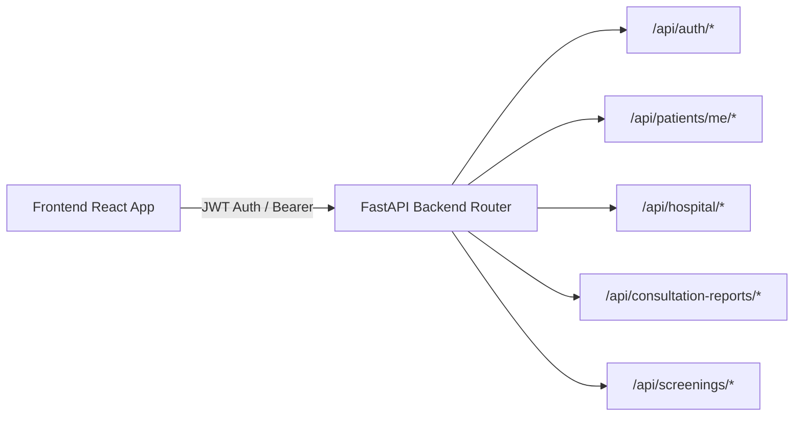
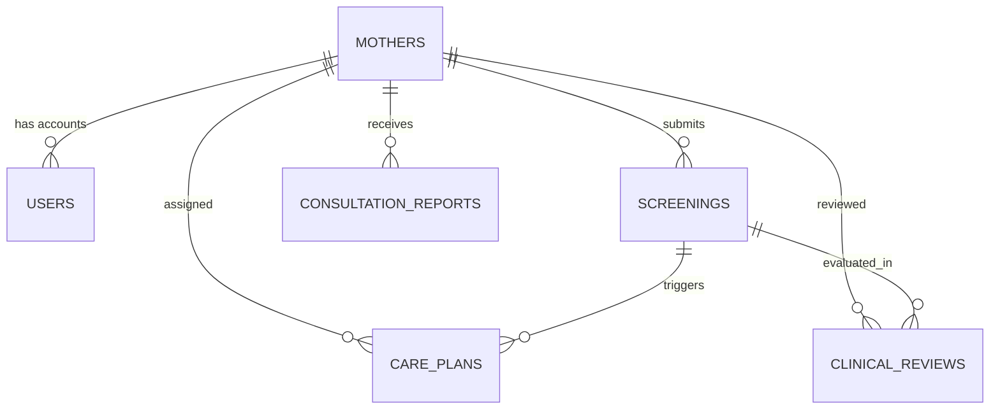
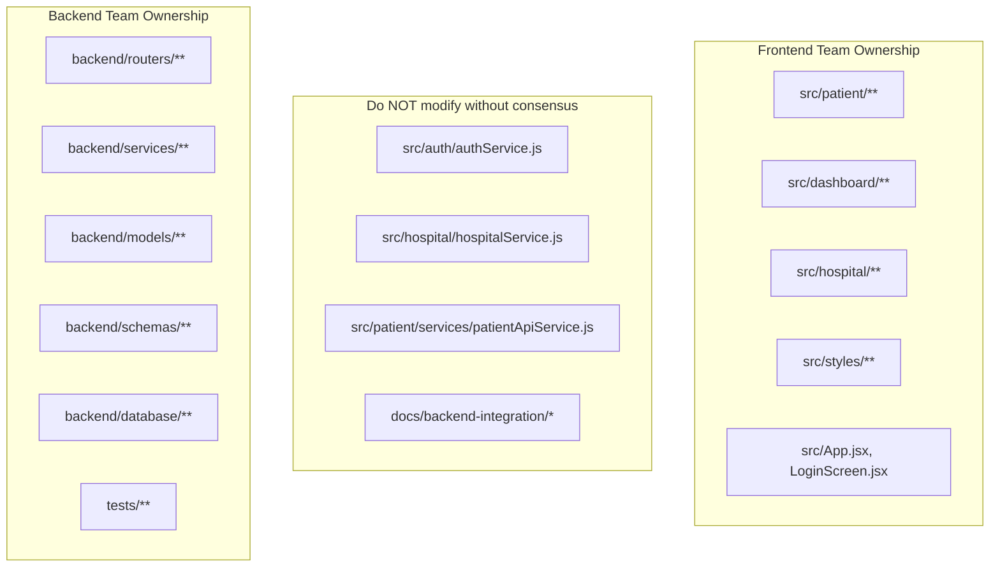
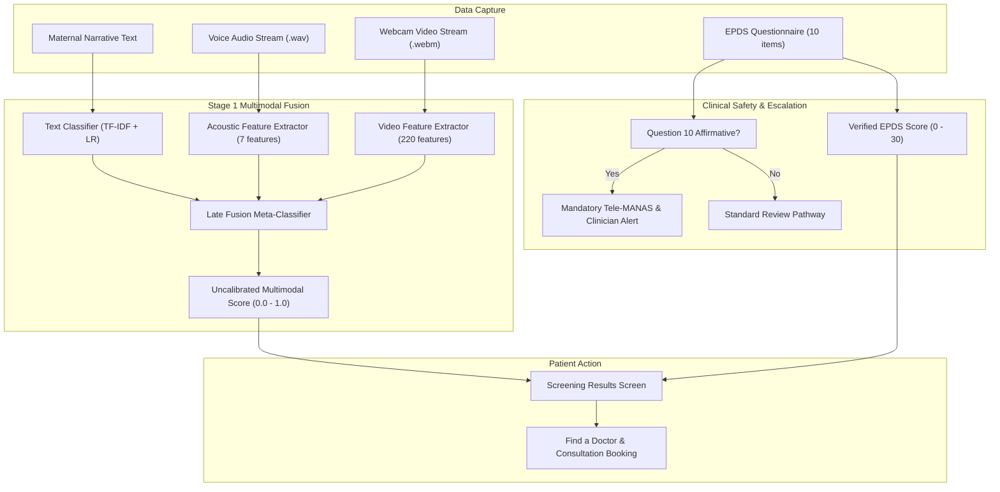
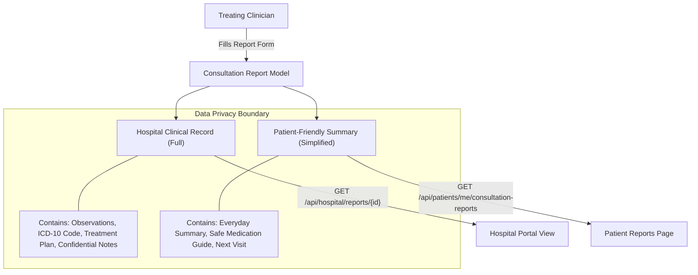
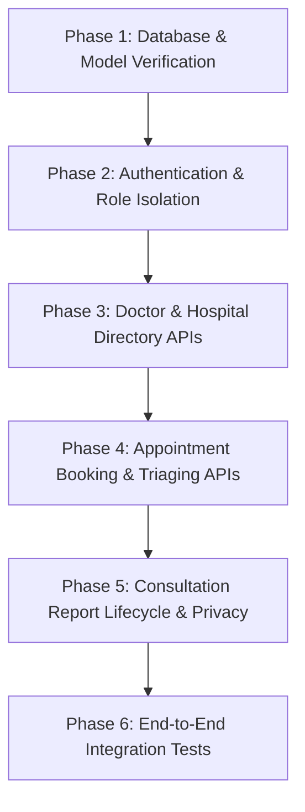

# AANCHAL — Frontend to Backend Integration Handover & Conflict Prevention Report

**Project:** AANCHAL (Maternal Emotional Intelligence & Perinatal Depression Screening)  
**Target Repository:** `https://github.com/nishasss692/ppd-screening.git`  
**Frontend Release Branch:** `frontend-changes-1`  
**Base Commit:** `0a74dd6`  
**Date:** 22 November 2026  
**Status:** Audit & Architecture Specification (Zero Source Code Changes)

---

## Executive Summary & Purpose

This document provides a comprehensive technical audit and integration handover from the frontend engineering team to the backend development team for the **AANCHAL** perinatal depression screening platform. 

The frontend team has completed and stabilized the four primary stakeholder portals:
1. **Patient Portal** (Self-care, screening, doctor discovery, appointment requests, consultation reports)
2. **Doctor / Clinician Portal** (Mothers cohort directory, clinical review, consultation report generation)
3. **Hospital Portal** (EHR administrative dashboard, appointment triaging, clinician assignment, clinical reports)
4. **Family Portal** (Partner & caregiver authentication, supportive access)

To enable the frontend and backend engineering teams to execute feature development concurrently without overwriting code, generating schema drift, or causing integration regressions, this document establishes:
- The exact state of the implemented user interface.
- Complete API contracts with request/response schemas.
- Database entity mappings and relational constraints.
- Mandatory collaboration rules and file ownership boundaries.
- The two-tier consultation reporting architecture with clinical privacy guarantees.

---

## 1. Audit of the Current Frontend Implementation

### 1.1 Patient Portal (`/patient/*`)
The patient user interface emphasizes warmth, clinical empathy, privacy, and seamless escalation to licensed human care.

| Feature / Workflow | Implemented UI Component / Route | Implementation Details & Backend Connection | Status |
| :--- | :--- | :--- | :--- |
| **Registration & Login** | `src/LoginScreen.jsx`, `src/CreateAccountScreen.jsx` (`/login`, `/create-account`) | Authenticates via JWT (`POST /api/auth/login`, `POST /api/auth/register`). Validates password length, role consistency, and session persistence in `localStorage`. Redirects to `/patient/dashboard`. | **IMPLEMENTED** |
| **Patient Profile & Settings** | `src/patient/pages/PatientProfilePage.jsx`, `PatientSettingsPage.jsx` | Reads/writes demographic info, emergency contact, notifications, and telemetry toggles via `GET`/`PUT /api/patients/me` and `GET`/`PUT /api/patients/me/settings`. | **IMPLEMENTED** |
| **Medical History** | `src/patient/pages/MedicalHistoryScreen.jsx` (`/patient/medical-history`) | Fetches and saves obstetric history, prior PPD episodes, and uploaded medical PDF summaries via `GET`/`PUT /api/patients/me/medical-history`. | **IMPLEMENTED** |
| **AI Screening: Video/Audio/Text** | `src/patient/components/screening/AiScreeningTab.jsx` (`/patient/screening`) | Captures live camera/mic stream (`MediaRecorder`), records 10-item questionnaire video session, collects text responses. Handles camera permissions, audio level visualization, and mandatory video consent. | **IMPLEMENTED** |
| **EPDS Questionnaire** | `src/patient/components/screening/EpdsTab.jsx` | 10-item Edinburgh Postnatal Depression Scale (EPDS) with 4-choice response options (0–3 scoring). Features question-by-question progression, auto-save, and Question 10 safety alert triggering. | **IMPLEMENTED** |
| **Results & Risk Display** | `src/patient/pages/ScreeningResultsPage.jsx` (`/patient/screening-results`) | Displays computed risk category (**Low Risk**, **Moderate Risk**, **High Risk**), EPDS total score (0–30), question breakdown, and multimodal modality cards (Audio, Video, Text, Fusion). | **IMPLEMENTED** |
| **Doctor Consultation Guidance** | `src/patient/pages/ScreeningResultsPage.jsx` | **Permanently accessible consultation card** positioned directly below the EPDS and Multimodal results. Displays tailored guidance for Low, Moderate, and High risk, with direct buttons navigating to `/patient/find-doctor`. | **IMPLEMENTED** |
| **Find a Doctor** | `src/patient/pages/FindDoctorPage.jsx` (`/patient/find-doctor`) | Geolocation-assisted and manual location search for verified perinatal specialists and hospitals. Displays doctor profile, hospital affiliation, years of experience, consultation types (In-person, Telehealth, Audio), and time slots. | **PARTIALLY IMPLEMENTED** (UI complete; uses verified sample data `src/patient/data/sampleDoctors.js` pending backend directory endpoint) |
| **Appointment Booking** | `src/patient/pages/AppointmentBookingPage.jsx` (`/patient/book-appointment`) | Allows selecting date, slot, reason for visit, and review of prefilled patient contact information. Posts to `POST /api/patients/me/appointments`. Displays confirmation screen with reference ID. | **IMPLEMENTED** |
| **Consultation Reports Section** | `src/patient/pages/PatientReportsPage.jsx` (`/patient/reports?tab=consultations`) | Dedicated tab presenting doctor-approved consultation reports. Displays doctor name, hospital, consultation date, everyday summary, approved medication guide, recommendations, and next visit info. | **IMPLEMENTED** (Integrated with `GET /api/patients/me/consultation-reports`) |

---

### 1.2 Doctor / Clinician Portal (`/mothers`, `/screening`, `/results`, `/clinical-review`)
The clinician portal provides perinatal mental health professionals with oversight, objective screening data, and documentation tools.

| Feature / Workflow | Implemented UI Component / Route | Implementation Details & Backend Connection | Status |
| :--- | :--- | :--- | :--- |
| **Authentication & Landing** | `src/LoginScreen.jsx`, `src/dashboard/components/TopNav.jsx` | Doctors log in via role `doctor`. Redirects immediately to `/mothers` (**Mothers & Cases**). **The legacy Doctor Dashboard (`/dashboard`) was completely removed from TopNav and workflow.** | **IMPLEMENTED** |
| **Mothers & Cases Cohort** | `src/dashboard/pages/MothersCasesPage.jsx` (`/mothers`) | Searchable, filterable patient table showing Patient ID, name, gestational/postpartum age, risk status, EPDS score, Q10 alerts, and last assessment date. Connected to `GET /api/mothers`. | **IMPLEMENTED** |
| **Doctor AI Screening Review** | `src/dashboard/components/screening/DoctorAiScreeningTab.jsx` (`/screening`) | Uncluttered clinical table of patient recordings, modality breakdown (Audio prosody, Facial action units, Text sentiment), and model status. Removed explanatory cards. | **IMPLEMENTED** |
| **Doctor EPDS Review** | `src/dashboard/components/screening/DoctorEpdsTab.jsx` | Detailed 10-item clinician review of patient EPDS questionnaire with item-level scoring and Question 10 safety banners. Removed academic definition cards. | **IMPLEMENTED** |
| **Clinical Review & Care Plans** | `src/dashboard/pages/ClinicalReviewPage.jsx`, `src/dashboard/pages/InsightsCarePage.jsx` | Clinical notes entry, diagnostic confirmation, risk categorization override, and care plan generation. Backed by `GET`/`POST /api/clinical-reviews` and `GET`/`POST /api/care-plans`. | **IMPLEMENTED** |
| **Create Consultation Report** | `src/dashboard/pages/CreateConsultationReportPage.jsx` (`/doctor/create-report`) | Complete consultation documentation workflow. Prefills patient data from query params (`?mother=M-108`). Generates **both** formal clinical EHR documentation and doctor-approved patient-friendly summaries. | **IMPLEMENTED** |
| **Save Draft & Submit Final Report** | `src/dashboard/pages/CreateConsultationReportPage.jsx` | Supports saving drafts (`status="draft"`) and official submission (`status="final"`). Connected to `POST /api/consultation-reports`. | **IMPLEMENTED** |

---

### 1.3 Hospital Portal (`/hospital/*`)
The hospital portal provides hospital administrative staff and department leads with triage, appointment coordination, and complete clinical record oversight using a deep teal/navy design system (`#003366`, `#008080`).

| Feature / Workflow | Implemented UI Component / Route | Implementation Details & Backend Connection | Status |
| :--- | :--- | :--- | :--- |
| **Hospital Staff Login** | `src/HospitalLoginScreen.jsx` (`/hospital-login`, `/login` Hospital tab) | Authenticates hospital staff using Email or Hospital ID (e.g. `HOSP-001`) via `POST /api/hospital/login`. Enforces hospital role check and stores isolated hospital session. | **IMPLEMENTED** |
| **Hospital Dashboard** | `src/hospital/HospitalDashboardPage.jsx` (`/hospital/dashboard`) | Displays aggregate metrics: Total Appointments, Pending Requests, Confirmed Appointments, Completed Consultations, and Cancelled/Declined. Backed by `GET /api/hospital/dashboard`. | **IMPLEMENTED** |
| **Appointment Requests List** | `src/hospital/HospitalAppointmentsPage.jsx` (`/hospital/appointments`) | Filterable table showing Patient Name, Case ID, Requested Doctor, Date, Time, Type (In-person/Telehealth), and Status (Pending, Confirmed, Completed, Cancelled). Backed by `GET /api/hospital/appointments`. | **IMPLEMENTED** |
| **Appointment Detail & Triaging** | `src/hospital/HospitalAppointmentDetailPage.jsx` (`/hospital/appointments/:id`) | Displays full appointment request details, patient contact phone, and requested schedule. Staff can Accept, Reject, Propose Alternative Date/Time, or Add Internal Notes (`PUT /api/hospital/appointments/{id}/status`). | **IMPLEMENTED** |
| **Doctor Assignment** | `src/hospital/HospitalAppointmentDetailPage.jsx` | Staff can assign or reassign an affiliated hospital doctor from a dropdown menu. Connected to `PUT /api/hospital/appointments/{id}/assign` and `GET /api/hospital/doctors`. | **IMPLEMENTED** |
| **Hospital Reports Directory** | `src/hospital/HospitalReportsPage.jsx` (`/hospital/reports`) | Searchable directory of submitted consultation reports. Filterable by doctor, date, and status. Connected to `GET /api/hospital/reports`. | **IMPLEMENTED** |
| **Detailed Clinical Report View** | `src/hospital/HospitalReportDetailPage.jsx` (`/hospital/reports/:id`) | Displays the complete clinical record: presenting concerns, mental state examination observations, formal ICD-10 diagnosis, treatment plan, medication regimen, follow-up instructions, and private hospital notes. Backed by `GET /api/hospital/reports/{id}`. | **IMPLEMENTED** |

---

### 1.4 Family Portal (`/login` Family tab)
- **Authentication & Registration:** Partners and family caregivers register and log in via `role="family"` with demo account `family@miora.health` / `password123` (`Raj K.`). Registration supports an optional `patient_email` field to associate the family member with an enrolled mother.
- **Current Flow:** Redirects to `/patient/dashboard` where the family member views the patient's care trajectory, recommended self-care activities, and appointment schedule.
- **Backend Dependencies:** Authenticated via `POST /api/auth/login` and `POST /api/auth/register`. In `backend/models/user.py`, the user has `role="family"` with a foreign key `mother_id` pointing to the enrolled `Mother` record.

---

## 2. Frontend API Contract Inventory

Below is the definitive inventory of every API contract required by the frontend application.



### Contract Status Classification Key
- **`IMPLEMENTED`**: Fully functional in FastAPI backend with database persistence and tested in CI.
- **`PARTIALLY IMPLEMENTED`**: Endpoint exists but requires refinement (e.g. metadata extraction or field expansion).
- **`MOCKED`**: Frontend handles data locally with mock fallbacks; backend API is pending.
- **`PROPOSED`**: Clean backend architecture proposed to replace legacy workarounds.

---

### 2.1 Authentication & Session Management

#### 2.1.1 User Login (`POST /api/auth/login`)
- **Status:** **`IMPLEMENTED`**
- **Consumer Files:** [authService.js](file:///c:/Users/Dell/Desktop/ppd-screening-latest/src/auth/authService.js#L153), [LoginScreen.jsx](file:///c:/Users/Dell/Desktop/ppd-screening-latest/src/LoginScreen.jsx)
- **Backend File:** `backend/routers/auth.py`
- **Method:** `POST`
- **Headers:** `Content-Type: application/json`
- **Request Payload:**
```json
{
  "email": "doctor@miora.health",
  "password": "password123",
  "selected_role": "doctor"
}
```
- **Response Structure (200 OK):**
```json
{
  "access_token": "eyJhbGciOiJIUzI1NiIsIn...",
  "token_type": "bearer",
  "redirect_url": "/mothers",
  "user": {
    "id": "e89c6d48-6a38-4e11-85b9-123456789abc",
    "email": "doctor@miora.health",
    "name": "Dr. Elena Rostova",
    "role": "doctor",
    "mother_id": null
  }
}
```
- **Role Enforcement:** If `selected_role` mismatches database `user.role`, returns `403 Forbidden` with a descriptive message preventing cross-portal unauthorized access.

#### 2.1.2 User Registration (`POST /api/auth/register`)
- **Status:** **`IMPLEMENTED`**
- **Consumer Files:** [authService.js](file:///c:/Users/Dell/Desktop/ppd-screening-latest/src/auth/authService.js#L393), [CreateAccountScreen.jsx](file:///c:/Users/Dell/Desktop/ppd-screening-latest/src/CreateAccountScreen.jsx)
- **Backend File:** `backend/routers/auth.py`
- **Method:** `POST`
- **Request Payload:**
```json
{
  "email": "priya.k@example.com",
  "password": "password123",
  "name": "Priya K.",
  "full_name": "Priya K.",
  "role": "patient",
  "patient_email": null
}
```
- **Response Structure (200 OK):** Same shape as Login with `access_token` and `user` object.

#### 2.1.3 Hospital Staff Login (`POST /api/hospital/login`)
- **Status:** **`IMPLEMENTED`**
- **Consumer Files:** [hospitalService.js](file:///c:/Users/Dell/Desktop/ppd-screening-latest/src/hospital/hospitalService.js#L60), [HospitalLoginScreen.jsx](file:///c:/Users/Dell/Desktop/ppd-screening-latest/src/HospitalLoginScreen.jsx)
- **Backend File:** `backend/routers/hospital.py`
- **Method:** `POST`
- **Request Payload:**
```json
{
  "email_or_id": "HOSP-001",
  "password": "password123"
}
```
- **Response Structure (200 OK):**
```json
{
  "access_token": "eyJhbGciOiJIUzI1NiIsIn...",
  "token_type": "bearer",
  "hospital": {
    "user_id": "f47ac10b-58cc-4372-a567-0e02b2c3d479",
    "hospital_id": "HOSP-001",
    "hospital_name": "Apollo Women's Hospital",
    "hospital_location": "Bangalore, Karnataka",
    "email": "apollo@hospital.miora.health",
    "role": "hospital"
  }
}
```

---

### 2.2 Patient Profile & Clinical Screening Endpoints

#### 2.2.1 Get Patient Profile (`GET /api/patients/me`)
- **Status:** **`IMPLEMENTED`**
- **Consumer Files:** [patientApiService.js](file:///c:/Users/Dell/Desktop/ppd-screening-latest/src/patient/services/patientApiService.js#L31), [PatientContext.jsx](file:///c:/Users/Dell/Desktop/ppd-screening-latest/src/patient/context/PatientContext.jsx)
- **Backend File:** `backend/routers/patients.py`
- **Auth:** Bearer Token (`role="patient"`)
- **Response Structure (200 OK):**
```json
{
  "id": "M-108",
  "mother_uuid": "3fa85f64-5717-4562-b3fc-2c963f66afa6",
  "name": "Amara K.",
  "email": "patient@miora.health",
  "phone": "+91-98765-43210",
  "age": 28,
  "postpartum_week": 6,
  "pregnancy_type": "singleton",
  "delivery_date": "2026-10-06",
  "assigned_doctor": "Dr. Elena Rostova",
  "clinic": "Apollo Women's Hospital"
}
```

#### 2.2.2 Save EPDS Questionnaire & Screening Session (`POST /api/patients/me/screenings`)
- **Status:** **`IMPLEMENTED`**
- **Consumer Files:** [patientApiService.js](file:///c:/Users/Dell/Desktop/ppd-screening-latest/src/patient/services/patientApiService.js#L105), [PatientContext.jsx](file:///c:/Users/Dell/Desktop/ppd-screening-latest/src/patient/context/PatientContext.jsx)
- **Backend File:** `backend/routers/patients.py`
- **Auth:** Bearer Token (`role="patient"`)
- **Request Payload:**
```json
{
  "answers": {
    "q1": 1, "q2": 2, "q3": 1, "q4": 0, "q5": 2,
    "q6": 1, "q7": 2, "q8": 1, "q9": 1, "q10": 0
  },
  "notes": "Patient reports poor sleep and occasional tearfulness.",
  "video_metadata": { "duration": 184, "format": "video/webm" },
  "question_timestamps": [
    { "question_id": "q1", "start_sec": 0.0, "end_sec": 14.2 }
  ]
}
```
- **Response Structure (200 OK):**
```json
{
  "screening_id": "9b1deb4d-3b7d-4bad-9bdd-2b0d7b3dcb6d",
  "total_score": 11,
  "risk_category": "Moderate Risk",
  "q10_alert": false,
  "created_at": "2026-11-22T08:30:00Z"
}
```

#### 2.2.3 Upload Continuous Screening Video (`POST /api/patients/me/screenings/{screening_id}/video`)
- **Status:** **`IMPLEMENTED`**
- **Consumer Files:** [patientApiService.js](file:///c:/Users/Dell/Desktop/ppd-screening-latest/src/patient/services/patientApiService.js#L128)
- **Backend File:** `backend/routers/patients.py`
- **Auth:** Bearer Token (`role="patient"`)
- **Content-Type:** `multipart/form-data`
- **Form Fields:** `video_file` (Binary Blob, webm/mp4), `duration_seconds` (float), `question_timestamps` (JSON string)
- **Response Structure (200 OK):**
```json
{
  "message": "Continuous screening video successfully uploaded and securely archived.",
  "screening_id": "9b1deb4d-3b7d-4bad-9bdd-2b0d7b3dcb6d",
  "video_duration_seconds": 184.5,
  "file_size_bytes": 14529812
}
```

---

### 2.3 Doctor Discovery & Hospital Directory

#### 2.3.1 Doctor Directory Listing (`GET /api/doctors`)
- **Status:** **`PROPOSED — BACKEND IMPLEMENTATION REQUIRED`**
- **Consumer File:** [FindDoctorPage.jsx](file:///c:/Users/Dell/Desktop/ppd-screening-latest/src/patient/pages/FindDoctorPage.jsx) (currently consumes static `sampleDoctors.js`)
- **Proposed Query Parameters:** `?location=Bangalore&specialization=Perinatal+Psychiatry`
- **Expected Response (200 OK):**
```json
[
  {
    "doctorId": "DR-001",
    "hospitalId": "HOSP-001",
    "name": "Dr. Priya Mehta",
    "initials": "PM",
    "specialization": "Perinatal Psychiatry",
    "subspecialties": ["Postpartum Depression", "Perinatal Anxiety"],
    "yearsExperience": 14,
    "availability": "Mon, Wed, Fri · 10:00 AM – 2:00 PM",
    "consultationTypes": ["In-person", "Telehealth"],
    "timeSlots": ["10:00 AM", "11:00 AM", "12:00 PM", "02:00 PM"],
    "hospital": {
      "hospitalId": "HOSP-001",
      "name": "Apollo Women's Hospital",
      "location": "Bangalore, Karnataka",
      "address": "154, Bannerghatta Road, Bangalore — 560 029",
      "phone": "+91 80-2222-3333"
    }
  }
]
```

#### 2.3.2 Hospital Directory Listing (`GET /api/hospitals`)
- **Status:** **`PROPOSED — BACKEND IMPLEMENTATION REQUIRED`**
- **Consumer Files:** [FindDoctorPage.jsx](file:///c:/Users/Dell/Desktop/ppd-screening-latest/src/patient/pages/FindDoctorPage.jsx), [sampleDoctors.js](file:///c:/Users/Dell/Desktop/ppd-screening-latest/src/patient/data/sampleDoctors.js)
- **Expected Response (200 OK):**
```json
[
  {
    "hospitalId": "HOSP-001",
    "name": "Apollo Women's Hospital",
    "location": "Bangalore, Karnataka",
    "address": "154, Bannerghatta Road, Bangalore — 560 029",
    "phone": "+91 80-2222-3333",
    "activeDoctorsCount": 4
  }
]
```

---

### 2.4 Appointment Booking & Management

#### 2.4.1 Patient Books Appointment (`POST /api/patients/me/appointments`)
- **Status:** **`IMPLEMENTED`**
- **Consumer Files:** [patientApiService.js](file:///c:/Users/Dell/Desktop/ppd-screening-latest/src/patient/services/patientApiService.js#L262), [AppointmentBookingPage.jsx](file:///c:/Users/Dell/Desktop/ppd-screening-latest/src/patient/pages/AppointmentBookingPage.jsx#L109)
- **Backend File:** `backend/routers/patients.py`
- **Auth:** Bearer Token (`role="patient"`)
- **Request Payload:**
```json
{
  "doctor_name": "Dr. Priya Mehta",
  "doctor_id": "DR-001",
  "role": "Perinatal Psychiatry",
  "hospital_id": "HOSP-001",
  "hospital_name": "Apollo Women's Hospital",
  "hospital_location": "Bangalore, Karnataka",
  "phone": "+91-98765-43210",
  "date": "2026-11-28",
  "time": "11:00 AM",
  "type": "In-person",
  "clinic": "Apollo Women's Hospital",
  "reason": "Persistent anxiety and trouble bonding with newborn."
}
```
- **Response Structure (200 OK):**
```json
{
  "id": "appt-7c9e6679-7425-40de-944b-e07fc1f90ae7",
  "doctorName": "Dr. Priya Mehta",
  "role": "Perinatal Psychiatry",
  "date": "2026-11-28",
  "time": "11:00 AM",
  "status": "pending",
  "type": "In-person",
  "clinic": "Apollo Women's Hospital",
  "created_at": "2026-11-22T08:45:00Z"
}
```

#### 2.4.2 Hospital Lists Appointments (`GET /api/hospital/appointments`)
- **Status:** **`IMPLEMENTED`**
- **Consumer Files:** [hospitalService.js](file:///c:/Users/Dell/Desktop/ppd-screening-latest/src/hospital/hospitalService.js#L87), [HospitalAppointmentsPage.jsx](file:///c:/Users/Dell/Desktop/ppd-screening-latest/src/hospital/HospitalAppointmentsPage.jsx)
- **Backend File:** `backend/routers/hospital.py`
- **Auth:** Bearer Token (`role="hospital"`)
- **Query Parameters:** `?status_filter=all` (or `pending`, `confirmed`, `completed`, `cancelled`)
- **Response Structure (200 OK):**
```json
[
  {
    "id": "appt-7c9e6679-7425-40de-944b-e07fc1f90ae7",
    "mother_id": "3fa85f64-5717-4562-b3fc-2c963f66afa6",
    "patient_name": "Amara K.",
    "patient_phone": "+91-98765-43210",
    "requested_doctor_id": "DR-001",
    "requested_doctor_name": "Dr. Priya Mehta",
    "assigned_doctor_id": "DR-001",
    "assigned_doctor_name": "Dr. Priya Mehta",
    "hospital_id": "HOSP-001",
    "hospital_name": "Apollo Women's Hospital",
    "requested_date": "28 Nov 2026",
    "requested_time": "11:00 AM",
    "status": "pending",
    "type": "In-person",
    "reason": "Persistent anxiety and trouble bonding with newborn.",
    "created_at": "2026-11-22T08:45:00Z"
  }
]
```

#### 2.4.3 Hospital Updates Appointment Status (`PUT /api/hospital/appointments/{id}/status`)
- **Status:** **`IMPLEMENTED`**
- **Consumer Files:** [hospitalService.js](file:///c:/Users/Dell/Desktop/ppd-screening-latest/src/hospital/hospitalService.js#L112), [HospitalAppointmentDetailPage.jsx](file:///c:/Users/Dell/Desktop/ppd-screening-latest/src/hospital/HospitalAppointmentDetailPage.jsx)
- **Backend File:** `backend/routers/hospital.py`
- **Auth:** Bearer Token (`role="hospital"`)
- **Request Payload:**
```json
{
  "action": "propose_alternative",
  "proposed_date": "29 Nov 2026",
  "proposed_time": "02:00 PM",
  "notes": "Dr. Priya is attending an emergency surgery on 28th morning."
}
```
- **Permitted Actions:** `"accept"`, `"reject"`, `"propose_alternative"`, `"cancel"`.
- **Response Structure (200 OK):** Returns the updated `HospitalAppointmentItem`.

#### 2.4.4 Hospital Assigns Doctor (`PUT /api/hospital/appointments/{id}/assign`)
- **Status:** **`IMPLEMENTED`**
- **Consumer Files:** [hospitalService.js](file:///c:/Users/Dell/Desktop/ppd-screening-latest/src/hospital/hospitalService.js#L130), [HospitalAppointmentDetailPage.jsx](file:///c:/Users/Dell/Desktop/ppd-screening-latest/src/hospital/HospitalAppointmentDetailPage.jsx)
- **Backend File:** `backend/routers/hospital.py`
- **Auth:** Bearer Token (`role="hospital"`)
- **Request Payload:**
```json
{
  "doctor_id": "DR-005",
  "doctor_name": "Dr. Elena Rostova"
}
```

---

### 2.5 Consultation Report Workflow Endpoints

#### 2.5.1 Doctor Creates Consultation Report (`POST /api/consultation-reports`)
- **Status:** **`IMPLEMENTED`**
- **Consumer File:** [CreateConsultationReportPage.jsx](file:///c:/Users/Dell/Desktop/ppd-screening-latest/src/dashboard/pages/CreateConsultationReportPage.jsx#L124)
- **Backend File:** `backend/routers/consultation_reports.py`
- **Auth:** Bearer Token (`role="doctor"` or `"clinician"`)
- **Request Payload:**
```json
{
  "patient_identifier": "M-108",
  "patient_name": "Amara K.",
  "appointment_id": "appt-7c9e6679-7425-40de-944b-e07fc1f90ae7",
  "doctor_id": "DR-005",
  "doctor_name": "Dr. Elena Rostova",
  "doctor_specialization": "Perinatal Psychiatry Lead",
  "hospital_id": "HOSP-001",
  "hospital_name": "Apollo Women's Hospital",
  "department": "Perinatal Mental Health",
  "consultation_date": "22 Nov 2026",
  "presenting_complaints": "Low mood, fractured sleep (<4 hrs), tearfulness.",
  "clinical_observations": "Cooperative, constricted dysphoric affect, coherent thought. Denies suicidal intent.",
  "clinical_assessment": "Postpartum depression with mild-to-moderate exhaustion (ICD-10 F53.0).",
  "treatment_plan": "Supportive CBT (6 sessions) + family sleep restoration.",
  "medications": "Prenatal vitamins + Magnesium Glycinate 200mg nightly.",
  "recommendations": "4-7-8 breathing exercises daily. Partner night feeding support.",
  "followup_instructions": "Review in 3 weeks. Tele-MANAS (14416) for emergencies.",
  "next_followup_date": "13 Dec 2026 at 11:00 AM",
  "additional_notes": "Husband Raj is supportive. Patient receptive to therapy.",
  "ai_screening_summary": "Acoustic prosody flat. EPDS score 14/30.",
  "epds_summary": "EPDS Total: 14/30. Q10: 0.",
  "status": "final",
  "patient_friendly_summary": "We discussed your tiredness and sadness over the past few weeks and agreed on a gentle plan to help you sleep and rest.",
  "patient_friendly_medications": "Continue daily vitamins and take magnesium before bed.",
  "patient_friendly_recommendations": "Practice breathing exercises daily and have family help with one night feed.",
  "patient_friendly_followup": "Next visit on 13 Dec 2026 at 11:00 AM. Call us if you need help earlier.",
  "approve_patient_version": true
}
```
- **Response Structure (200 OK):**
```json
{
  "id": "e4b02534-1188-4c12-bd77-0d92f58e1c39",
  "report_code": "REP-2026-002",
  "patient_identifier": "M-108",
  "doctor_name": "Dr. Elena Rostova",
  "hospital_name": "Apollo Women's Hospital",
  "status": "final",
  "patient_approved": true,
  "created_at": "2026-11-22T08:50:00Z"
}
```

#### 2.5.2 Hospital Staff Views Reports (`GET /api/hospital/reports` & `GET /api/hospital/reports/{id}`)
- **Status:** **`IMPLEMENTED`**
- **Consumer Files:** [hospitalService.js](file:///c:/Users/Dell/Desktop/ppd-screening-latest/src/hospital/hospitalService.js#L157), [HospitalReportsPage.jsx](file:///c:/Users/Dell/Desktop/ppd-screening-latest/src/hospital/HospitalReportsPage.jsx), [HospitalReportDetailPage.jsx](file:///c:/Users/Dell/Desktop/ppd-screening-latest/src/hospital/HospitalReportDetailPage.jsx)
- **Backend File:** `backend/routers/hospital.py`
- **Auth:** Bearer Token (`role="hospital"`)
- **Isolation Guarantee:** Returns reports strictly filtered by the authenticated user's `hospital_id`.
- **Detail Response (200 OK):** Returns all clinical and administrative fields, including `clinical_observations`, `clinical_assessment`, and `additional_notes`.

#### 2.5.3 Patient Retrieves Simplified Reports (`GET /api/patients/me/consultation-reports`)
- **Status:** **`IMPLEMENTED`**
- **Consumer Files:** [PatientReportsPage.jsx](file:///c:/Users/Dell/Desktop/ppd-screening-latest/src/patient/pages/PatientReportsPage.jsx#L34)
- **Backend File:** `backend/routers/patients.py`
- **Auth:** Bearer Token (`role="patient"`)
- **Privacy Filtering Guarantee:** Only returns reports where `patient_approved == True` and `status == "final"`.
- **Response Structure (200 OK):**
```json
[
  {
    "id": "e4b02534-1188-4c12-bd77-0d92f58e1c39",
    "report_code": "REP-2026-002",
    "doctor_name": "Dr. Elena Rostova",
    "doctor_specialization": "Perinatal Psychiatry Lead",
    "hospital_name": "Apollo Women's Hospital",
    "consultation_date": "22 Nov 2026",
    "summary": "We discussed your tiredness and sadness over the past few weeks...",
    "medications_instructions": "Continue daily vitamins and take magnesium before bed.",
    "recommendations": "Practice breathing exercises daily and have family help with one night feed.",
    "followup_instructions": "Next visit on 13 Dec 2026 at 11:00 AM.",
    "next_followup_date": "13 Dec 2026 at 11:00 AM",
    "submitted_at": "22 Nov 2026"
  }
]
```
> [!IMPORTANT]
> **Strict Clinical Privacy Rule:** `additional_notes`, raw differential diagnostic codes, and unapproved draft notes are **omitted from the serialization schema** for this endpoint.

---

## 3. Database and Data Model Requirements

### 3.1 Existing Database Models (`backend/models/`)

The application currently has the following SQLAlchemy ORM models configured:



1. **`users` (`backend/models/user.py`):**
   - Primary Key: `id` (UUID).
   - Fields: `email` (unique index), `hashed_password`, `full_name`, `role` (`'patient'`, `'doctor'`, `'hospital'`, `'family'`, `'admin'`), `is_active`, `mother_id` (Nullable Foreign Key to `mothers.id`).
2. **`mothers` (`backend/models/mother.py`):**
   - Primary Key: `id` (UUID).
   - Fields: `name`, `age`, `phone`, `email`, `delivery_date`, `pregnancy_type`, `medical_history` (Text/JSON), `notes` (used for portal settings and metadata).
3. **`screenings` (`backend/models/screening.py`):**
   - Primary Key: `id` (UUID).
   - Foreign Key: `mother_id` (`mothers.id`).
   - Fields: `screening_date`, `instrument`, `total_score`, `risk_classification`, `q10_safety_alert` (Boolean), `submitted_answers` (JSON), `item_scores` (JSON), `screening_status`, `fusion_status`, `modality_status` (JSON), `multimodal_scores` (JSON).
4. **`care_plans` (`backend/models/care_plan.py`):**
   - Primary Key: `id` (UUID).
   - Foreign Keys: `mother_id` (`mothers.id`), `screening_id` (nullable).
   - Fields: `priority`, `intervention_type`, `referral_destination`, `scheduled_followup_date`, `assigned_clinician_id`, `status`, `notes` (Text/JSON containing appointment booking metadata).
5. **`consultation_reports` (`backend/models/consultation_report.py`):**
   - Primary Key: `id` (UUID).
   - Foreign Key: `mother_id` (`mothers.id`).
   - Fields: `report_code` (unique human ID, e.g. `REP-2026-001`), `patient_name`, `patient_identifier`, `appointment_id`, `doctor_id`, `doctor_name`, `doctor_specialization`, `hospital_id`, `hospital_name`, `department`, `consultation_date`, `presenting_complaints`, `clinical_observations`, `clinical_assessment`, `treatment_plan`, `medications`, `recommendations`, `followup_instructions`, `next_followup_date`, `additional_notes` (private), `status` (`'draft'` or `'final'`), `patient_friendly_*` fields, `patient_approved` (Boolean), `submitted_at`.

---

### 3.2 Proposed Entity Refinements & Recommendations

#### Appointment Request Entity Refinement
Currently, appointment requests are stored inside the `care_plans` table, parsing structured JSON in the `care_plan.notes` field.
* **Backend Recommendation:** For production scalability, create a dedicated `appointments` table (or continue standardizing the `CarePlan` mapping with clear database migration scripts) with the following explicit schema:
  - `id` (UUID, Primary Key)
  - `mother_id` (UUID, Foreign Key to `mothers.id`)
  - `hospital_id` (String(64), indexed)
  - `doctor_id` (String(64), indexed)
  - `doctor_name` (String(128))
  - `requested_date` (Date)
  - `requested_time` (String(32))
  - `confirmed_date` (Date, nullable)
  - `confirmed_time` (String(32), nullable)
  - `status` (Enum: `pending`, `confirmed`, `completed`, `cancelled`, `declined`)
  - `consultation_type` (Enum: `In-person`, `Telehealth`, `Audio Consult`)
  - `reason` (Text, nullable)
  - `hospital_notes` (Text, nullable)

#### Stable ID Conventions
To avoid data desynchronization between portals:
- **Patient ID:** Use existing short identifier `M-108` mapped to the canonical `mother.id` (UUID).
- **Hospital ID:** String prefix `HOSP-` followed by three digits (e.g. `HOSP-001`).
- **Doctor ID:** String prefix `DR-` followed by three digits (e.g. `DR-005`).
- **Report Code:** String prefix `REP-` + year + sequential number (e.g. `REP-2026-001`).

---

## 4. MANDATORY RULES TO PREVENT FRONTEND–BACKEND CONFLICTS

> [!CAUTION]
> **READ BEFORE TOUCHING ANY CODE:** To prevent breaking production builds or wiping team progress, every engineer on the backend and frontend must follow these rules.

### 4.1 Git Collaboration Rules
1. **Branch Ownership:**
   - The frontend team owns and pushes to branch `frontend-changes-1` (and subsequent frontend branches).
   - The backend team **must create a separate branch**, e.g. `backend-integration-1`.
   - **Never push directly to `main` or `master`.**
2. **Never Force-Push:** Running `git push --force` or `git push -f` is strictly forbidden across all shared branches.
3. **No Overwriting:** Never run `git reset --hard` on another developer's branch or rebase commits already pushed to the remote repository.
4. **Clean Commits:**
   - Never commit `.env` or files containing secrets/API keys (monitored by GitHub Push Protection).
   - Never commit SQLite database files (`*.db`), virtual environments (`.venv/`), or test cache directories (`.pytest_cache/`).
5. **Pull Requests:** All cross-team integrations must be merged via GitHub Pull Requests after passing automated build and test checks.

---

### 4.2 File Ownership Boundaries



- **Frontend-Owned Files:** The backend team should **never modify** files inside `src/patient/`, `src/dashboard/`, `src/hospital/`, `src/styles/`, or UI presentation components.
- **Backend-Owned Files:** The frontend team should **never modify** files inside `backend/routers/`, `backend/services/`, `backend/models/`, `backend/schemas/`, or `backend/database/`.
- **Shared Integration Files:** 
  - `src/auth/authService.js`
  - `src/hospital/hospitalService.js`
  - `src/patient/services/patientApiService.js`
  - *Modification Rule:* If an endpoint URL, query parameter, or JSON key must change, both teams must agree in writing in this documentation before updating the shared client service.

---

### 4.3 API Contract Rules
1. **Case Consistency:**
   - Request payloads from frontend use `snake_case` (e.g. `doctor_id`, `hospital_id`, `consultation_date`).
   - Responses from FastAPI must maintain matching `snake_case` properties.
2. **Date & Time Standards:**
   - Timestamps must be formatted in **ISO 8601 UTC** with timezone offset (e.g. `2026-11-22T08:50:00Z`).
   - Human-readable consultation dates must accept `DD Mon YYYY` (e.g. `22 Nov 2026`).
3. **Structured Errors:** Every error response must return standard FastAPI HTTPException structure:
   ```json
   {
     "detail": "Descriptive human-readable explanation of why the action failed."
   }
   ```
4. **No Silent Field Removal:** Never remove or rename an existing response property without providing a backwards-compatible alias for at least one sprint.

---

### 4.4 Authentication & Data Isolation Rules
1. **Single Unified JWT:** All portals (Patient, Doctor, Hospital, Family) authenticate using the existing JWT architecture in `backend/services/auth_service.py`. Do **not** spin up a second auth provider or session cookie system.
2. **Strict Hospital Isolation:** Hospital endpoints (`/api/hospital/*`) **must filter every query** by the authenticated user's `hospital_id`. A hospital staff member from `HOSP-001` must never receive appointment or clinical data belonging to `HOSP-002`.
3. **Doctor Verification:** Only authenticated users with `role in ("doctor", "clinician", "admin")` may draft or submit clinical consultation reports.
4. **Patient Privacy:** Patients can only query records where `mother_id == current_user.mother_id`.

---

### 4.5 Database Migration Rules
1. Never manually run raw SQL `DROP TABLE` or `ALTER TABLE` against shared database instances.
2. Use **Alembic migrations** for schema evolution.
3. Default development databases must continue to support SQLite fallback (`ppd_clinical_dev.db`) for seamless CI/local unit testing without requiring a running PostgreSQL service.

---

## 5. Screening and ML Integration Dependencies

### 5.1 Architecture Overview



### 5.2 Current Implementation vs. Pending Status
- **Text Modality:** Baseline TF-IDF + Logistic Regression model is connected via `backend/services/three_modality_service.py` (`models/text_model/text_pipeline.joblib`).
- **Audio Modality:** 7-feature acoustic pipeline is configured (`models/audio_model/`), but real-time feature extraction from raw audio files requires server-side FFmpeg and OpenSMILE/Librosa preprocessing.
- **Video Modality:** 220 facial dynamics statistical model is trained (`artifacts/video_experiments/`), awaiting real-time landmark extraction integration (MediaPipe / OpenFace).
- **Multimodal Fusion:** Stacking meta-classifier is trained in `artifacts/three_modality_fusion/`.

### 5.3 Critical Decoupling Mandate
> [!IMPORTANT]
> 1. **Consultation Access Is NOT Gated on ML:** The patient's ability to discover perinatal doctors (`/patient/find-doctor`) and book appointments (`/patient/book-appointment`) must function 100% reliably even when ML models return `status="unavailable"` or `"awaiting model integration"`.
> 2. **EPDS Question 10 Independence:** EPDS Question 10 (self-harm risk) escalation triggers immediate crisis helplines (Tele-MANAS `14416`, NIMHANS `080-46110007`) **purely based on questionnaire response > 0**, regardless of what AI scores indicate. AI scores must **never** override a Question 10 clinical safety flag.

---

## 6. Consultation Report Integration Contract

To comply with clinical documentation requirements and patient mental health privacy guidelines, the system enforces a **Two-Tier Report Architecture**.



### 6.1 Field Segregation & Access Matrix

| Field Name | Hospital EHR View (`/api/hospital/reports/*`) | Patient Portal View (`/api/patients/me/consultation-reports`) | Notes / Privacy Rule |
| :--- | :---: | :---: | :--- |
| `report_code` | **YES** | **YES** | Stable tracking ID (e.g. `REP-2026-001`) |
| `doctor_name` | **YES** | **YES** | Treating doctor's full name |
| `doctor_specialization` | **YES** | **YES** | Clinical specialty |
| `hospital_name` | **YES** | **YES** | Facility name |
| `consultation_date` | **YES** | **YES** | Date of consultation |
| `presenting_complaints` | **YES** | **NO** | Clinical notes; summarized for patient |
| `clinical_observations` | **YES** | **NO** | Clinician mental state examination notes |
| `clinical_assessment` | **YES** | **NO** | Formal psychiatric diagnosis & ICD-10 codes |
| `treatment_plan` | **YES** | **NO** | Detailed clinical intervention plan |
| `additional_notes` | **YES** | **STRICTLY EXCLUDED** | Private clinician/administrative notes |
| `medications` (Full) | **YES** | **NO** | Clinical prescription details |
| `patient_friendly_summary` | **YES** | **YES** | Plain everyday language explanation |
| `patient_friendly_medications`| **YES** | **YES** | Patient-safe everyday instructions |
| `patient_friendly_recommendations`| **YES**| **YES** | Supportive lifestyle & sleep advice |
| `patient_friendly_followup` | **YES** | **YES** | Clear next appointment instructions |
| `next_followup_date` | **YES** | **YES** | Scheduled date of next visit |

### 6.2 Doctor Approval Workflow
A consultation report is only published to the patient portal when:
1. `status == "final"` (the doctor has signed off on the consultation).
2. `patient_approved == True` (the doctor has reviewed and approved the patient-friendly language).
3. If `status == "draft"`, the report is visible **only** to the authoring doctor and hospital staff.

---

## 7. Recommended Backend Integration Sequence

To minimize blocking dependencies, the backend team should execute their work in the following sequential phases:



1. **Phase 1 — Schema & Database Verification:**
   - Verify that SQLite dev fallback and PostgreSQL production connection execute cleanly.
   - Confirm `users`, `mothers`, `care_plans`, and `consultation_reports` tables exist with correct indices.
2. **Phase 2 — Authentication & Access Control:**
   - Verify JWT token generation for all 4 roles (`patient`, `doctor`, `hospital`, `family`).
   - Validate that hospital staff tokens carry the correct `hospital_id` claim in JWT payloads.
3. **Phase 3 — Directory Services:**
   - Complete `GET /api/doctors` and `GET /api/hospitals` to serve dynamic database records to `FindDoctorPage.jsx`.
4. **Phase 4 — Appointment Lifecycle:**
   - Test `POST /api/patients/me/appointments` persistence.
   - Test `GET /api/hospital/appointments` with hospital isolation.
   - Test `PUT /api/hospital/appointments/{id}/status` (accept/reject/propose).
   - Test `PUT /api/hospital/appointments/{id}/assign` (clinician assignment).
5. **Phase 5 — Consultation Reporting:**
   - Test `POST /api/consultation-reports` draft and final submissions.
   - Validate that `GET /api/patients/me/consultation-reports` excludes `additional_notes` and unapproved drafts.
6. **Phase 6 — Full Integration Verification:**
   - Run end-to-end test suite (`pytest`) verifying all 4 stakeholder flows.

---

## 8. Backend Test Matrix

The backend engineering team should implement test cases matching the following verification criteria in `tests/`:

| Test Name | Test Target & Scenario | Expected Result |
| :--- | :--- | :--- |
| `test_patient_login_and_profile` | Patient logs in and fetches profile. | Returns 200 with linked `mother_id` and personal details. |
| `test_role_mismatch_rejection` | Doctor attempts to log into `/api/auth/login` with `selected_role="patient"`. | Returns 403 Forbidden with descriptive mismatch message. |
| `test_hospital_data_isolation` | Hospital A staff attempts to view appointment request belonging to Hospital B. | Returns 404 Not Found or 403 Forbidden. Cross-hospital access blocked. |
| `test_appointment_request_lifecycle`| Patient creates appointment -> Hospital accepts -> Doctor is assigned. | State transitions cleanly from `pending` to `confirmed` with assigned doctor. |
| `test_consultation_report_draft` | Doctor creates draft report (`status="draft"`). | Report is saved; patient endpoint does NOT return it. |
| `test_consultation_report_final_privacy` | Doctor submits final report (`status="final"`, `patient_approved=True`). Patient fetches reports. | Returns 200 OK; response body does NOT contain `additional_notes` or `clinical_observations`. |
| `test_epds_q10_safety_escalation` | Patient submits EPDS with Item 10 > 0. | `q10_safety_alert` is set to `True` in database; emergency contact info returned. |
| `test_screening_fallback_when_ml_offline` | ML inference engine is offline or model weights missing. | EPDS screening saves successfully; doctor consultation button remains accessible. |

---

## 9. Handover Sign-off & Contact Matrix

| Team | Lead / Contact | Ownership Focus |
| :--- | :--- | :--- |
| **Frontend Engineering** | React / UI Development Team | User experience, responsive layouts, accessibility, client-side state, form validation. |
| **Backend Engineering** | FastAPI / Python Development Team | REST endpoints, authentication security, SQLAlchemy models, database migrations, clinical privacy enforcement. |

*Generated on 22 Nov 2026 for the AANCHAL Perinatal Depression Screening Platform.*
