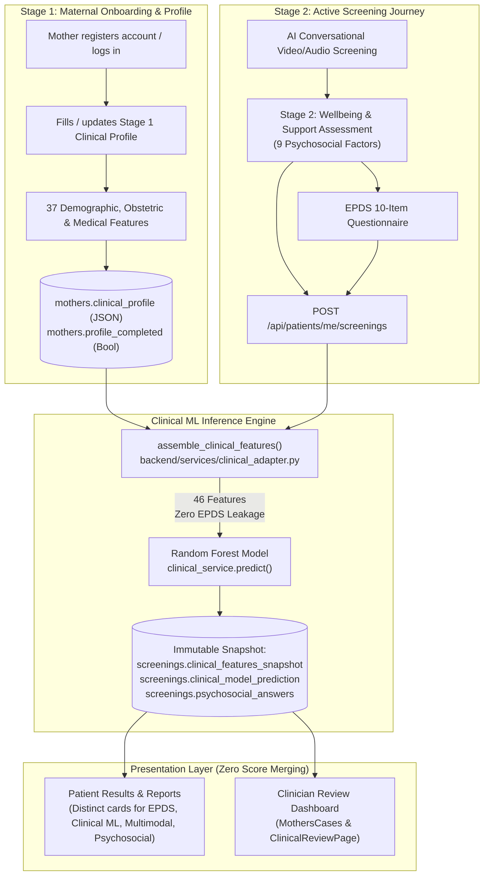

# AANCHAL — Two-Stage Clinical Data Collection (Backend Handover & Engineering Guide)

**Target Audience:** Backend Development Team & ML Engineers  
**Project:** AANCHAL (Maternal Postpartum Wellbeing Screening System)  
**Branch:** `aachal-moments`  
**Architecture Finalized:** Option B (Separate Clinical Profile & Screening Assessments)  
**Status:** Implemented, Integrated, and Verified

---

## 1. Executive Summary & Architecture

The AANCHAL clinical numerical risk model is a pre-trained **Random Forest Classifier** (`models/clinical_numerical/random_forest.joblib`) with a scikit-learn preprocessor (`models/clinical_numerical/preprocessor.joblib`) that evaluates **exactly 46 features**.

To avoid burdening mothers during an acute emotional screening, we separated data collection into two distinct stages:



---

## 2. Database Schema Changes & Migration

The changes modify two core SQLAlchemy entities. A non-destructive dynamic migration was implemented inside `backend/database/connection.py::init_db()` to support both SQLite and PostgreSQL without manual Alembic scripts.

### 2.1 Table: `mothers` (`backend/models/mother.py`)

| Column | Type | Nullable | Default | Description |
|---|---|---|---|---|
| `clinical_profile` | `JSON` | No | `{}` | Key-value store of all 37 Stage 1 demographic, socioeconomic, obstetric, and medical history features. |
| `profile_completed` | `Boolean` | No | `False` | Flag indicating whether the mother has completed her baseline clinical profile. |

### 2.2 Table: `screenings` (`backend/models/screening.py`)

| Column | Type | Nullable | Default | Description |
|---|---|---|---|---|
| `psychosocial_answers` | `JSON` | Yes | `None` | Key-value store of the 9 Stage 2 psychosocial responses collected during that specific screening session. |
| `clinical_features_snapshot` | `JSON` | Yes | `None` | **Immutable audit record** of the exact 46 features passed to the Random Forest model during inference. Profile edits never alter this historical snapshot. |
| `clinical_model_prediction` | `JSON` | Yes | `None` | Output from the Random Forest model: `status`, `predicted_class`, `predicted_label`, `predicted_risk_probability`, `risk_category`, `model_utilized`. |

---

## 3. API Endpoints & Request/Response Contracts

### 3.1 `GET /api/patients/me/clinical-profile`
Retrieves the authenticated mother's Stage 1 clinical profile.

- **Headers:** `Authorization: Bearer <JWT>`
- **Response (200 OK):**
```json
{
  "profile_completed": true,
  "clinical_profile": {
    "Age": 28,
    "Residence": "Urban",
    "Education Level": "Graduate",
    "Marital status": "Married",
    "Occupation before latest pregnancy": "Private Job",
    "Monthly income before latest pregnancy": "40000",
    "Occupation After Your Latest Childbirth": "Housewife",
    "Current monthly income": "0",
    "Husband's education level": "Post Graduate",
    "Husband’s monthly income": "60000",
    "Addiction": "No",
    "Family type": "Nuclear",
    "Number of household members": 4,
    "Total children": 1,
    "Number of the latest pregnancy": 1,
    "Age of immediate older children": "None",
    "Disease before pregnancy": "None",
    "History of pregnancy loss": "No",
    "Pregnancy plan": "Planned",
    "Regular checkups": "Regular",
    "Pregnancy length": "Full Term",
    "Mode of delivery": "Normal",
    "Birth compliancy": "Yes",
    "Diseases during pregnancy": "None",
    "Major changes or losses during pregnancy": "No",
    "Fear of pregnancy": "No",
    "Depression before pregnancy (PHQ2)": "No",
    "Depression during pregnancy (PHQ2)": "No",
    "Age of newborn": "4 weeks",
    "Gender of newborn": "Female",
    "Breastfeed": "Exclusive",
    "Newborn illness": "No",
    "Worry about newborn": "No",
    "Relationship with the newborn": "Warm",
    "Relationship between father and newborn": "Warm",
    "Abuse": "No",
    "Feeling for regular activities": "Normal"
  }
}
```

### 3.2 `PUT /api/patients/me/clinical-profile`
Updates the Stage 1 clinical profile. Sensitive questions are optional; answers such as "Prefer not to answer" are accepted.

- **Headers:** `Authorization: Bearer <JWT>`
- **Request Body:**
```json
{
  "profile_completed": true,
  "clinical_profile": {
    "Age": 29,
    "Residence": "Urban",
    "Mode of delivery": "Normal",
    "Pregnancy plan": "Planned"
  }
}
```

### 3.3 `POST /api/patients/me/screenings`
Submits a screening session. Accepts EPDS answers together with Stage 2 `psychosocial_answers`.

- **Headers:** `Authorization: Bearer <JWT>`
- **Request Body:**
```json
{
  "answers": [
    {"question_id": "EPDS_Q01", "selected_index": 0},
    {"question_id": "EPDS_Q02", "selected_index": 0},
    {"question_id": "EPDS_Q03", "selected_index": 0},
    {"question_id": "EPDS_Q04", "selected_index": 0},
    {"question_id": "EPDS_Q05", "selected_index": 0},
    {"question_id": "EPDS_Q06", "selected_index": 0},
    {"question_id": "EPDS_Q07", "selected_index": 0},
    {"question_id": "EPDS_Q08", "selected_index": 0},
    {"question_id": "EPDS_Q09", "selected_index": 0},
    {"question_id": "EPDS_Q10", "selected_index": 0}
  ],
  "total_score": 0,
  "risk_classification": "low",
  "psychosocial_answers": {
    "Feeling about motherhood": "Happy",
    "Relationship with husband": "Friendly",
    "Relationship with the in-laws": "Good",
    "Relax/sleep when the newborn is asleep": "Yes",
    "Relax/sleep when newborn is tended ": "Yes",
    "Angry after latest child birth": "No",
    "Recieved Support": "High",
    "Need for Support": "Low",
    "Trust and share feelings": "Yes",
    "qualitative_reflection": "Doing well overall with husband helping at night."
  }
}
```
- **Backend Execution Flow:**
  1. Validates and scores 10 EPDS responses using `questionnaire_service`.
  2. Pulls `mother.clinical_profile` and combines with `payload.psychosocial_answers`.
  3. Calls `backend/services/clinical_adapter.py::assemble_clinical_features`.
  4. If features are sufficient (`is_suitable == True`), executes `clinical_service.predict(mother_id, features)`.
  5. Saves `psychosocial_answers`, `clinical_features_snapshot`, and `clinical_model_prediction` directly into `Screening`.

---

## 4. The 46-Feature Mapping Specification

### 4.1 Stage 1: 37 Clinical Profile Features
| Feature Name in Model | Type | Accepted Canonical Values |
|---|---|---|
| `Age` | Float | Numeric years (e.g. `28.0`) |
| `Residence` | String | `Urban`, `Rural`, `Semi-Urban`, `Missing` |
| `Education Level` | String | `Illiterate`, `Primary`, `High School`, `College`, `Graduate`, `Post Graduate`, `Missing` |
| `Marital status` | String | `Married`, `Unmarried`, `Divorced`, `Widowed`, `Separated`, `Missing` |
| `Occupation before latest pregnancy` | String | `Housewife`, `Private Job`, `Govt Job`, `Business`, `Student`, `Unemployed`, `Missing` |
| `Monthly income before latest pregnancy` | String | `Below 10000`, `10000-25000`, `25000-50000`, `Above 50000`, `Missing` |
| `Occupation After Your Latest Childbirth` | String | `Housewife`, `Private Job`, `Govt Job`, `Business`, `Student`, `Unemployed`, `Missing` |
| `Current monthly income` | String | `0`, `Below 10000`, `10000-25000`, `25000-50000`, `Above 50000`, `Missing` |
| `Husband's education level` | String | `Illiterate`, `Primary`, `High School`, `College`, `Graduate`, `Post Graduate`, `Missing` |
| `Husband’s monthly income` | String | `Below 15000`, `15000-30000`, `30000-60000`, `Above 60000`, `Missing` |
| `Addiction` | String | `No`, `Yes`, `Tobacco`, `Alcohol`, `Missing` |
| `Family type` | String | `Nuclear`, `Joint`, `Extended`, `Missing` |
| `Number of household members` | String | `1-3`, `4-6`, `7+`, `Missing` |
| `Total children` | String | `1`, `2`, `3+`, `Missing` |
| `Number of the latest pregnancy` | Float | `1.0`, `2.0`, `3.0`, etc. |
| `Age of immediate older children` | String | `None`, `< 2 years`, `2-5 years`, `> 5 years`, `Missing` |
| `Disease before pregnancy` | String | `None`, `Thyroid`, `Diabetes`, `Hypertension`, `PCOS`, `Other`, `Missing` |
| `History of pregnancy loss` | String | `No`, `Yes`, `Abortion`, `Miscarriage`, `Stillbirth`, `Missing` |
| `Pregnancy plan` | String | `Planned`, `Unplanned`, `Missing` |
| `Regular checkups` | String | `Regular`, `Irregular`, `None`, `Missing` |
| `Pregnancy length` | String | `Full Term`, `Preterm`, `Post Term`, `Missing` |
| `Mode of delivery` | String | `Normal`, `Cesarean`, `Instrumental`, `Missing` |
| `Birth compliancy` | String | `Yes`, `No`, `Missing` |
| `Diseases during pregnancy` | String | `None`, `Gestational Diabetes`, `Preeclampsia`, `Anemia`, `Missing` |
| `Major changes or losses during pregnancy` | String | `No`, `Yes`, `Missing` |
| `Fear of pregnancy` | String | `No`, `Yes`, `Missing` |
| `Depression before pregnancy (PHQ2)` | String | `No`, `Yes`, `Missing` |
| `Depression during pregnancy (PHQ2)` | String | `No`, `Yes`, `Missing` |
| `Age of newborn` | String | `< 1 month`, `1-3 months`, `3-6 months`, `6-12 months`, `Missing` |
| `Gender of newborn` | String | `Female`, `Male`, `Other`, `Missing` |
| `Breastfeed` | String | `Exclusive`, `Formula`, `Mixed`, `None`, `Missing` |
| `Newborn illness` | String | `No`, `Yes`, `Jaundice`, `Infection`, `NICU Stay`, `Missing` |
| `Worry about newborn` | String | `No`, `Yes`, `Missing` |
| `Relationship with the newborn` | String | `Warm`, `Good`, `Detached`, `Difficult`, `Missing` |
| `Relationship between father and newborn` | String | `Warm`, `Good`, `Distant`, `Missing` |
| `Abuse` | String | `No`, `Yes`, `Missing` |
| `Feeling for regular activities` | String | `Normal`, `Fatigued`, `Loss of Interest`, `Missing` |

### 4.2 Stage 2: 9 Psychosocial Screening Features
| Feature Name in Model | Importance | Canonical Options |
|---|---|---|
| `Feeling about motherhood` | Medium | `Happy`, `Neutral`, `Sad`, `Missing` |
| `Relationship with husband` | High | `Friendly`, `Good`, `Neutral`, `Poor`, `Bad`, `Missing` |
| `Relationship with the in-laws` | Medium | `Friendly`, `Good`, `Neutral`, `Poor`, `Bad`, `Missing` |
| `Relax/sleep when the newborn is asleep` | High | `Yes`, `No`, `Missing` |
| `Relax/sleep when newborn is tended ` *(note trailing space)* | High | `Yes`, `No`, `Missing` |
| `Angry after latest child birth` | **25.62% (#1)** | `No`, `Yes`, `Missing` |
| `Recieved Support` | High | `High`, `Medium`, `Low`, `Missing` |
| `Need for Support` | High | `Low`, `Medium`, `High`, `Missing` |
| `Trust and share feelings` | High | `Yes`, `No`, `Missing` |

> [!CAUTION]
> **Exact Key Preservation Requirement:**  
> The feature `"Relax/sleep when newborn is tended "` **must have the trailing space**. The trained scikit-learn preprocessor artifact was serialized with this exact column header. Any renaming or trimming causes the preprocessor to raise a feature mismatch `KeyError`.

> [!IMPORTANT]
> **Strict Anti-Leakage Guarantee:**  
> Neither `EPDS Score`, `EPDS Result`, nor any individual question `EPDS_Q01`-`EPDS_Q10` must **ever** be added to the dictionary passed to `clinical_service.predict()`. The adapter automatically strips any key containing `"epds"` to maintain strict clinical independence.

---

## 5. Backend Files Modified & Added

1. **`backend/models/mother.py`**: Added `clinical_profile` and `profile_completed`.
2. **`backend/models/screening.py`**: Added `psychosocial_answers`, `clinical_features_snapshot`, and `clinical_model_prediction`.
3. **`backend/database/connection.py`**: Added dynamic non-destructive migration in `init_db()`.
4. **`backend/schemas/patient_portal.py`**: Added schemas for profile endpoints and screening requests.
5. **`backend/services/clinical_adapter.py`** *(NEW)*: Implements feature validation, mapping, trailing space preservation, and anti-leakage checks.
6. **`backend/routers/patients.py`**: Implemented `GET/PUT /api/patients/me/clinical-profile` and wired inference into `POST /api/patients/me/screenings`.
7. **`tests/test_two_stage_clinical.py`** *(NEW)*: End-to-end pytest test suite.

---

## 6. How to Run Verification Tests

Run the targeted test suite using the project's virtual environment:

```powershell
.\.venv-demo\Scripts\python.exe -m pytest tests/test_two_stage_clinical.py -v
```

**Expected output:**
```
tests/test_two_stage_clinical.py::test_feature_adapter_exact_46_features PASSED
tests/test_two_stage_clinical.py::test_feature_adapter_prefer_not_to_answer_maps_to_missing PASSED
tests/test_two_stage_clinical.py::test_clinical_profile_api_endpoints PASSED
============================== 3 passed in 7.68s ==============================
```
