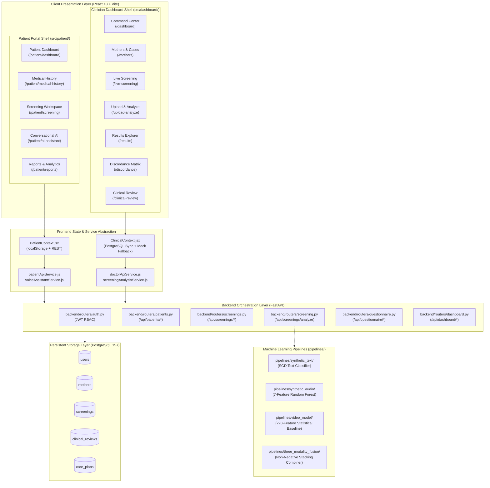
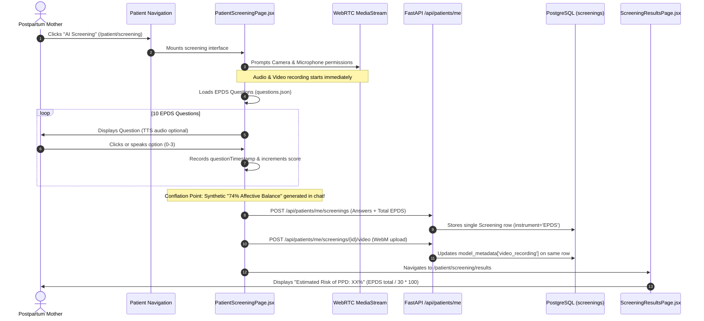
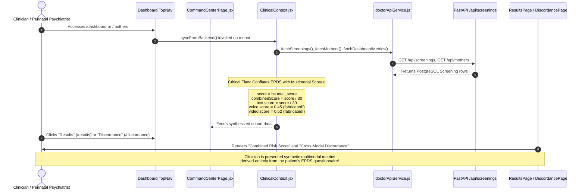
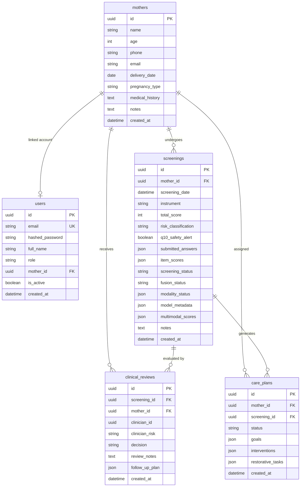
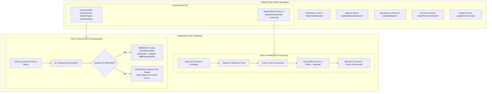
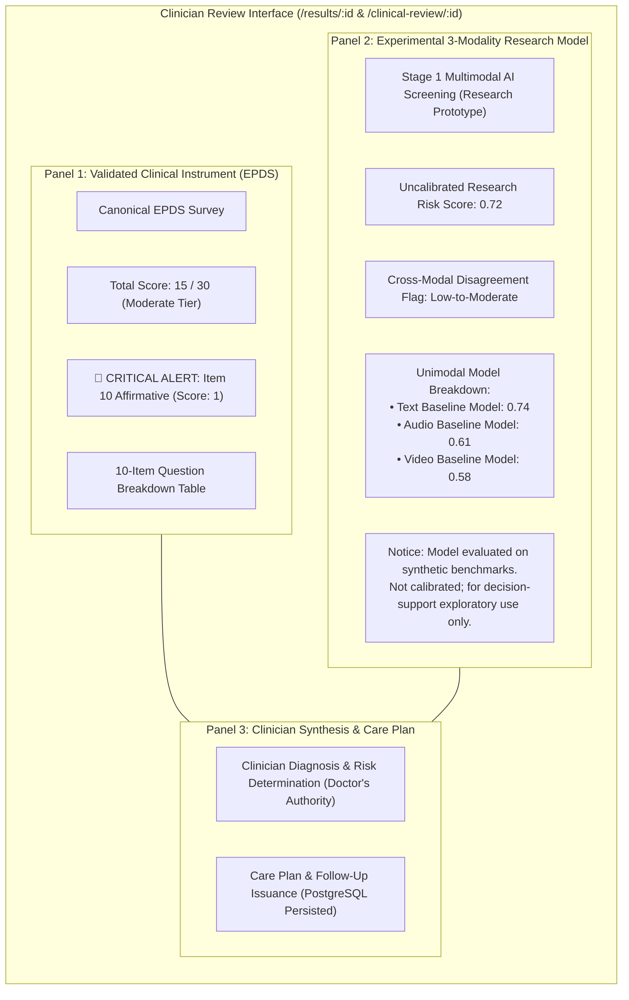
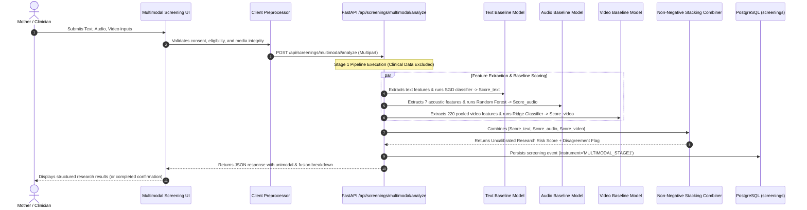
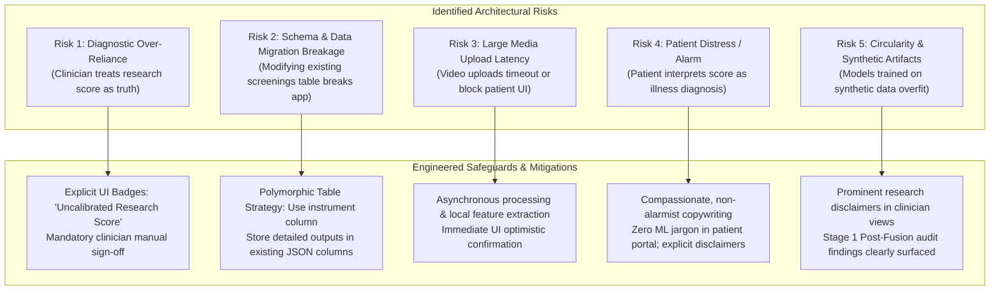
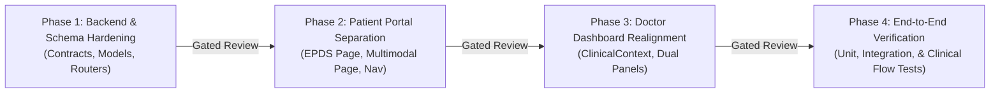

# AANCHAL — Patient & Doctor Dashboard Integration Architecture & Audit Report

**Document ID:** AANCHAL-ARCH-2026-05  
**Version:** 1.0.0 (Comprehensive Pre-Implementation Blueprint)  
**Date:** November 19, 2026  
**Status:** Architecture Planning & Reliability Audit (READ-ONLY — Awaiting User Approval)  
**System:** AANCHAL Multimodal Postpartum Depression (PPD) Screening Platform (MIORA)  
**Target File:** `reports/AANCHAL_DASHBOARD_INTEGRATION_ARCHITECTURE.md`

---

## Executive Summary

Following the completion of the Stage 1 Three-Modality Fusion experiment (`artifacts/three_modality_fusion/`) and the Stage 1 Research Documentation Review (`reports/AANCHAL_STAGE1_RESEARCH_DOCUMENTATION_REVIEW.md`), this document provides a comprehensive audit of the existing AANCHAL application codebase and establishes a complete architectural blueprint for integrating the multimodal screening system into the frontend patient and clinician dashboards.

### Core Strategic Mandates
1. **Strict Separation of Assessment Paradigms**:
   - **Component A (Experimental Multimodal AI Screening)**: Integrates exactly three non-clinical signals—Text (NLP entity extraction/sentiment), Audio (acoustic vocal biomarkers), and Video (facial/gaze dynamics)—producing an **Uncalibrated Multimodal Research Risk Score** ($0.0 - 1.0$) and a **Cross-Modal Algorithmic Disagreement Flag**. It explicitly excludes all clinical covariates and questionnaire inputs. It does NOT generate clinical diagnoses or calibrated disease probabilities.
   - **Component B (Validated Clinical EPDS Assessment)**: Preserves the canonical 10-item Edinburgh Postnatal Depression Scale (EPDS) instrument ($0 - 30$ score), validated clinical risk classifications (Low $\le 9$, Moderate $10-12$, High $\ge 13$), and immediate emergency safety escalation for Question 10 (self-harm). It is strictly isolated from the Stage 1 ML inference engine.
2. **Elimination of Frontend Conflation & Fabricated Surrogates**:
   - The audit discovered that `src/dashboard/context/ClinicalContext.jsx` currently divides the EPDS questionnaire score by 30 and synthesizes mock "Text", "Voice", and "Video" scores, creating a false multimodal impression from a pure survey.
   - The patient portal (`src/patient/pages/PatientScreeningPage.jsx` and `ScreeningResultsPage.jsx`) currently forces mothers to record video while answering clinical questions and labels the normalized EPDS score as an "Estimated Risk of PPD (%)".
   - The architecture proposed herein completely eliminates these fabrications, providing clean, honest, and scientifically grounded user journeys.
3. **Scope & Guardrails**:
   - **Read-Only Planning**: No backend code, frontend components, database tables, or ML models have been altered. This document serves as the formal engineering proposal awaiting explicit user sign-off.

---

## 1. Existing Architecture Overview

The AANCHAL/MIORA application is structured as a modern full-stack clinical decision-support and patient-engagement web application.



### Component Details
- **Frontend Stack**: React 18, React Router DOM v6, Vite, Lucide/Custom SVG icons, Recharts for visual analytics, and browser MediaStream / Web Speech APIs.
- **Backend Stack**: Python 3.11+, FastAPI, SQLAlchemy 2.0 ORM, Pydantic v2 schemas, PostgreSQL database (with psycopg2 driver), and bcrypt/JWT authentication.
- **Port & Runtime Mapping**:
  - Frontend development server: `http://localhost:5173` (or port assigned by Vite).
  - FastAPI backend service: `http://localhost:8000`.
  - PostgreSQL database: `localhost:5432` (`ppd_db`).
- **Access Control & Roles**: Defined in `backend/models/user.py` supporting `role="patient"` (linked via `mother_id` foreign key) and `role="doctor"` / `role="admin"`.

---

## 2. Current Patient Screening Journey

Tracing the actual execution path in `src/patient/` reveals significant conceptual and UI entanglement:



### Identified Deficiencies in Current Patient Flow
1. **Conflation of Modalities**: A mother seeking to take the standardized clinical EPDS survey is simultaneously forced into a high-friction video and microphone capture flow.
2. **Fabricated Feedback**: `PatientScreeningPage.jsx` (lines 531-532) displays a hardcoded chat bubble claiming: *"Multimodal video analysis complete. Visual affective dynamics and conversational engagement indicate mild maternal fatigue (74% Affective Balance)..."* before any backend ML model has evaluated the video.
3. **Misleading Risk Gauge**: `ScreeningResultsPage.jsx` (lines 22-30) computes `Math.round((screening.totalScore / 30) * 100)` and renders it as an *"Estimated Risk of PPD"* percentage gauge, violating psychometric standards (EPDS is an ordinal symptom severity scale, not a probabilistic risk percentage).
4. **Redundant Reports Routes**: In `src/App.jsx` and `src/patient/components/PatientSidebar.jsx`, navigation contains `/patient/reports`, `/patient/my-reports`, `/reports`, and `/my-reports`, confusing patients between clinical screening history, consultation records, and downloadable PDFs.

---

## 3. Current Doctor Screening Journey

Tracing the clinician workflow through `src/dashboard/`:



### Identified Deficiencies in Current Doctor Flow
1. **Surrogate Score Fabrication**: In `src/dashboard/context/ClinicalContext.jsx` (lines 337-350), when raw backend screenings from PostgreSQL are loaded, the system constructs a fake multimodal payload:
   ```javascript
   combinedScore: Number((score / 30).toFixed(2)),
   modalities: {
     text: { status: 'completed', score: Number((score / 30).toFixed(2)) },
     voice: cap.voice ? { status: 'completed', score: 0.45 } : { status: 'unavailable', score: null },
     video: cap.video ? { status: 'completed', score: 0.52 } : { status: 'unavailable', score: null },
   }
   ```
2. **Submersion of the EPDS Instrument**: On the doctor's `ClinicalReviewPage.jsx` and `DiscordancePage.jsx`, there is no dedicated EPDS card displaying the 10 canonical question responses or the raw 0-30 score. Instead, the EPDS score is relabeled as *"Self-report (Text)"* inside the AI screening widget.
3. **Decoupled Backend Orchestrator**: The backend orchestrator at `POST /api/screenings/analyze` (`backend/routers/screening.py`) is completely disconnected from the live screening UI, leaving the clinician dashboard dependent on frontend mocks or synthetic mappings.

---

## 4. Existing Frontend Components and Routes

### Route Table (`src/App.jsx`)

| Path | Layout / Shell | Component | Current Purpose | Audit Assessment |
| :--- | :--- | :--- | :--- | :--- |
| `/patient/dashboard` | `PatientLayout` | `PatientHomePage` | Patient overview, greeting, quick actions | Displays misleading "Postpartum Wellness Index: 64%" |
| `/patient/medical-history` | `PatientLayout` | `MedicalHistoryScreen` | Obstetrical intake & prior PPD history | Clean form; properly linked to `Mother.medical_history` |
| `/patient/screening` | `PatientLayout` | `PatientScreeningPage` | Live interactive screening workspace | Conflates EPDS with WebRTC recording; synthetic text |
| `/patient/screening/results` | `PatientLayout` | `ScreeningResultsPage` | Screening outcome presentation | Conflates EPDS 0-30 score as a percentage risk gauge |
| `/patient/reports` | `PatientLayout` | `PatientReportsPage` | Multi-tab patient reports & PDF downloads | Well-designed, but duplicate routes exist in routing tree |
| `/patient/ai-assistant` | `PatientLayout` | `AiAssistantScreen` | Conversational avatar & voice assistant | Duplicates EPDS questionnaire engine inside chat |
| `/patient/connect-doctor` | `PatientLayout` | `ConnectDoctorPage` | Doctor consultation booking | Functional booking UI; ties into patient appointments |
| `/patient/community` | `PatientLayout` | `CommunityPage` | Mother's Circle peer support forum | Fully functional PostgreSQL-backed community module |
| `/dashboard` | `DashboardLayout` | `CommandCenterPage` | Clinician cohort overview & KPIs | Synchronizes live PostgreSQL data with mock fallbacks |
| `/mothers` | `DashboardLayout` | `MothersCasesPage` | Patient directory & triage list | Robust sorting, filtering, and risk badges |
| `/live-screening` | `DashboardLayout` | `LiveScreeningPage` | Clinician-administered live session | Simulates multimodal capture with heuristic scoring |
| `/upload-analyze` | `DashboardLayout` | `UploadAnalyzePage` | Batch media & text upload interface | Validates files; ready for `/api/screenings/analyze` |
| `/results/:motherId?` | `DashboardLayout` | `ResultsPage` | Individual screening risk breakdown | Shows combined score, modality cards, risk trends |
| `/discordance/:motherId?` | `DashboardLayout` | `DiscordancePage` | Cross-modal divergence evaluation | Compares modalities; needs research label updates |
| `/clinical-review/:motherId?` | `DashboardLayout` | `ClinicalReviewPage` | Decision recording & Care Plan issuance | Stores clinician review & care plans in PostgreSQL |
| `/insights/:motherId?` | `DashboardLayout` | `InsightsCarePage` | Trend trajectory & supportive resources | Clean visualizations of historical check-ins |

### Navigation & Breadcrumb Redundancies
- **Duplicate Routes**: `/patient/reports`, `/patient/my-reports`, `/reports`, `/my-reports` all route to `PatientReportsPage`. In the sidebar, having multiple entry points confuses user orientation.
- **Conflated Search Paths**: In `src/patient/components/PatientSidebar.jsx`, the "AI Screening" nav item matches 7 different path strings (`/patient/screening`, `/screening`, `/ai-screening`, `/patient-screening`, etc.).

---

## 5. Existing Backend APIs and Schemas

### API Route Inventory

| Router File | Route Prefix | Method & Endpoint | Request Schema / Form | Response Schema | Audit Notes |
| :--- | :--- | :--- | :--- | :--- | :--- |
| `patients.py` | `/api/patients` | `POST /me/screenings` | `ScreeningSubmissionSaveRequest` | `PatientScreeningSummaryResponse` | Calculates EPDS and stores in `screenings` table |
| `patients.py` | `/api/patients` | `POST /me/screenings/{id}/video` | Multipart (`video_file`, `timestamps`) | `PatientScreeningSummaryResponse` | Saves WebM video to disk (`data/raw/recordings/`) |
| `patients.py` | `/api/patients` | `GET /me/screenings` | None (Auth token) | `List[PatientScreeningSummaryResponse]` | Returns patient's historical screenings |
| `patients.py` | `/api/patients` | `GET /me/reports` | None (Auth token) | `PatientReportsOverviewResponse` | Synthesizes latest screening & notification records |
| `screening.py` | `/api/screenings` | `POST /analyze` | Multipart (`clinical`, `text`, `audio`, `video`) | `ScreeningAnalysisResponse` | Legacy 4-modality orchestrator; needs 3-modality update |
| `screenings.py` | `/api` | `GET /screenings` | Query (`skip`, `limit`) | `List[ScreeningResponse]` | Clinician list of all screenings across all mothers |
| `screenings.py` | `/api` | `GET /screenings/{id}` | Path (`screening_id`) | `ScreeningResponse` | Detailed screening retrieval |
| `questionnaire.py`| `/api/questionnaire` | `GET /epds` | None | `EPDSQuestionnaireResponse` | Returns canonical 10 questions from `data/questions.json` |
| `questionnaire.py`| `/api/questionnaire` | `POST /epds/submit` | `EPDSSubmissionRequest` | `EPDSSubmissionResponse` | Scores EPDS, enforces Item 10 safety alert |
| `dashboard.py` | `/api/dashboard` | `GET /metrics` | None | `DashboardMetricsResponse` | Cohort KPIs (total, high risk, reviews pending) |
| `dashboard.py` | `/api/dashboard` | `GET /alerts` | None | `DashboardAlertsResponse` | Emergency alerts (EPDS Q10 triggers, high risk) |

### Schema Audit & Discrepancies
1. **`backend/schemas/screening.py`**:
   - Lines 313-324 define `FusionModalityResult`:
     ```python
     combined_score: Optional[float] = Field(None, description="Calibrated multimodal risk probability")
     epds_equivalent: Optional[int] = Field(None, description="Estimated equivalent EPDS score")
     ```
   - **Correction Required**: Per the Stage 1 reliability audit, `combined_score` must be updated to `"Uncalibrated multimodal research risk score ($0.0 - 1.0$)"`, and `epds_equivalent` must be completely deprecated/removed as multimodal AI does not estimate EPDS scores.
   - `ScreeningAnalysisResponse` currently includes `clinical: ClinicalModalityResult`. In the Stage 1 Three-Modality architecture, clinical data is excluded from the primary fusion model.

---

## 6. Existing Database Relationships

The database is built on PostgreSQL with SQLAlchemy 2.0 ORM (`backend/models/`).



### Database Storage Patterns & Observations
- **Single Table Storage**: Currently, `screenings` table records both pure EPDS surveys (`instrument='EPDS'`) and multimodal evaluations (`instrument='Multimodal'`).
- **Flexible JSON Payload**: Columns `model_metadata` and `multimodal_scores` store arbitrary JSON dictionaries. This enables non-breaking extension: Stage 1 three-modality fusion metrics can be stored directly inside `multimodal_scores` without breaking existing migrations.
- **Item 10 Safety Flag**: `q10_safety_alert` is a indexed boolean column on `screenings`. It is never overwritten by ML inference, guaranteeing that an affirmative response on EPDS Question 10 triggers platform-wide safety escalations.

---

## 7. Proposed Patient Dashboard Structure

The patient portal must provide a supportive, non-stigmatizing experience that clearly separates clinical symptom reporting from experimental AI check-ins.



### Detailed Patient Dashboard Improvements

#### A. Navigation & Information Architecture
1. **Assessments Hub**: Replace the ambiguous *"AI Screening"* sidebar link with two clearly distinguished assessment options:
   - **Maternal Wellbeing AI Check-In** (`/patient/multimodal-screening`): An experimental reflection session exploring thoughts, vocal expression, and optional video dynamics.
   - **Standard Clinical Questionnaire (EPDS)** (`/patient/epds-questionnaire`): The validated 10-item clinical self-report scale.
2. **De-duplicated Reports**: Consolidate all report routes into a single canonical route `/patient/reports`, removing redundant `/patient/my-reports` and `/reports` aliases.

#### B. Patient-Facing UI Language and Tone
1. **Zero Technical Jargon**: Strictly eliminate machine learning terminology from patient screens. The patient should never encounter words like *"Random Forest"*, *"Out-of-Fold"*, *"AR(1) Simulation"*, *"Stacking Logistic Regression"*, *"Confidence Intervals"*, or *"Concealment Phenotype"*.
2. **Supportive, Non-Alarmist Phrasing**:
   - Instead of *"PPD Risk Score: 64% High"*, use: *"Your recent check-in reflects noticeable emotional fatigue and stress. We encourage you to share these reflections with your healthcare provider."*
   - Instead of *"Estimated Risk of PPD"*, use: *"Screening Reflection Summary"*.
3. **Transparent Assessment Framing**:
   - For EPDS: *"The Edinburgh Postnatal Depression Scale is a widely used 10-question screening instrument. It helps you and your doctor understand how you have been feeling over the past week. It is not a medical diagnosis."*
   - For Multimodal AI: *"This experimental wellness tool looks at speech patterns, self-expression, and facial cues to provide supportive insights. It is a research aid and does not provide clinical findings."*

#### C. Visual Status & Progress Tracking
The patient dashboard (`PatientHomePage.jsx`) will present two distinct, non-overlapping status cards:
- **Card 1: Clinical Survey Status**: Shows date of last EPDS completion, status badge (*"Routine Check-In Complete"*, *"Follow-Up Recommended"*), and a link to view the formal clinical report.
- **Card 2: Wellbeing AI Check-In Status**: Shows date of last multimodal session (*"Check-In Recorded on Apr 18"*) with an option to start a new check-in.

---

## 8. Proposed Doctor Dashboard Structure

The clinician dashboard must present high-density, rigorous clinical decision-support data while maintaining total clarity between clinical instruments and research models.



### Detailed Doctor Dashboard Improvements

#### A. Structured Multi-Panel Review (`ResultsPage.jsx` & `ClinicalReviewPage.jsx`)
1. **Dedicated EPDS Clinical Panel**:
   - Displays the true total score out of 30.
   - Highlights EPDS risk tier: Low ($0-9$), Moderate ($10-12$), or High ($\ge 13$).
   - Prominent, unmissable red alert badge if Question 10 (self-harm thoughts) $> 0$, detailing the patient's exact response.
   - Expandable breakdown of all 10 item scores ($0-3$).
2. **Dedicated Multimodal Research Panel**:
   - Clearly labeled: *"Stage 1 Three-Modality Multimodal Screening (Experimental Research Prototype)"*.
   - Displays the **Uncalibrated Multimodal Research Risk Score** ($0.0 - 1.0$) with an explicit badge: *"Uncalibrated Research Score"*.
   - Unimodal score breakdown:
     * **Text Modality**: Prediction score ($0.0 - 1.0$), top biomedical entity cues, sentiment orientation.
     * **Audio Modality**: Prediction score ($0.0 - 1.0$), 7 acoustic feature metrics (pitch variation, jitter, shimmer, pause ratio).
     * **Video Modality**: Prediction score ($0.0 - 1.0$), summary of pooled facial action units and gaze dynamics.
   - **Cross-Modal Algorithmic Disagreement Flag**: Indicates whether individual modality scores diverge significantly (e.g. divergence $> 0.35$), alerting the clinician to check for contextual factors (e.g. high verbal fatigue vs. calm facial demeanor).
3. **Clinician Diagnostic Authority**:
   - The system will NEVER display an automated diagnosis (e.g. *"Diagnosed with Major PPD"*).
   - The diagnosis and care plan remain exclusively within the clinician's manual sign-off section (`ClinicalReviewPage.jsx`), which is persisted to the `clinical_reviews` table in PostgreSQL.

---

## 9. Proposed Multimodal Screening Data Flow

The operational end-to-end data pipeline for the primary experimental screening workflow:



### Modality Ingestion & Preprocessing Specifications
1. **Text Modality**:
   - *Input*: Narrative transcript from patient check-in or clinician notes (UTF-8 string, max 10,000 characters).
   - *Preprocessing*: Biomedical entity extraction (`TextNERPredictor`), TF-IDF / SGD scoring against vocabulary.
   - *Model Artifact*: `models/text_model/baseline_sgd_text_classifier.joblib`.
2. **Audio Modality**:
   - *Input*: Pre-extracted 7 physiological acoustic features (`f0_mean_hz`, `f0_std_hz`, `jitter_local_percent`, `shimmer_local_percent`, `hnr_db`, `speech_rate_syllables_per_sec`, `pause_ratio`) or raw audio waveform.
   - *Preprocessing*: Scaled via training StandardScaler (`audio_scaler.joblib`).
   - *Model Artifact*: `models/audio_model/baseline_random_forest_audio.joblib`.
3. **Video Modality**:
   - *Input*: Continuous video recording (WebM / MP4) or pre-extracted dynamic facial action units / gaze landmark trajectories.
   - *Preprocessing*: Temporal pooling over video sequence into 220 statistical features (mean, std, min, max over 55 landmark signals).
   - *Model Artifact*: `models/video_model/baseline_video_model.joblib`.
4. **Three-Modality Fusion Engine**:
   - *Inputs*: Exactly $[\hat{y}_{text}, \hat{y}_{audio}, \hat{y}_{video}]$. Explicitly NO clinical survey features or EPDS items.
   - *Combiner*: Non-Negative Stacking Logistic Regression (`artifacts/three_modality_fusion/fusion_nonnegative_stacking_model.joblib`).
   - *Output*: Composite Research Score $\in [0.0, 1.0]$ and pairwise divergence metrics.

---

## 10. EPDS and Multimodal Assessment Separation

To guarantee scientific rigor, regulatory safety, and patient trust, the platform enforces strict structural and runtime isolation between the two assessments:

| Dimension | Component A: Multimodal AI Screening | Component B: Clinical EPDS Questionnaire |
| :--- | :--- | :--- |
| **Primary Purpose** | Experimental decision-support research exploring affective cues | Standardized clinical screening for depressive symptoms |
| **Input Signals** | Text narrative, Acoustic vocal features, Facial dynamics | 10 standardized ordinal questions ($0-3$ rating) |
| **Clinical Inputs** | **STRICTLY ZERO** (No survey covariates, no EPDS data) | Patient self-report responses to 10 questions |
| **Output Metric** | **Uncalibrated Multimodal Research Risk Score** ($0.0 - 1.0$) | **Standard EPDS Total Score** ($0 - 30$) |
| **Clinical Classification** | Cross-modal algorithmic disagreement flag only | Validated clinical tiers: Low ($\le 9$), Moderate ($10-12$), High ($\ge 13$) |
| **Safety Escalations** | None (purely behavioral observation) | **Immediate Critical Escalation** on Question 10 $> 0$ |
| **Diagnostic Status** | Experimental research prototype; NOT a diagnosis | Validated clinical screening scale; NOT a diagnosis |
| **Database Identifier** | `instrument = "MULTIMODAL_STAGE1"` | `instrument = "EPDS"` |
| **Patient Navigation** | `/patient/multimodal-screening` | `/patient/epds-questionnaire` |
| **Doctor Dashboard Tab** | *"Multimodal AI Research Explorer"* | *"Clinical EPDS Survey Breakdown"* |

---

## 11. Missing Components and APIs

To implement the proposed architecture without breaking existing functionality, the following additions are required:

### Frontend Components to Build / Refactor
1. **`src/patient/pages/PatientMultimodalScreeningPage.jsx`**:
   - Standalone screening page dedicated strictly to media capture (text narrative, voice recording, optional video).
   - Does NOT render EPDS questions or compute survey totals.
   - Employs non-stigmatizing, warm maternal design language.
2. **`src/patient/pages/PatientEpdsQuestionnairePage.jsx`**:
   - Clean, focused 10-item clinical questionnaire interface.
   - Instant score calculation upon completion with clear medical disclaimer.
   - Immediate hardwired crisis support popup if Question 10 is scored $> 0$.
3. **`src/dashboard/components/EPDSClinicalReviewCard.jsx`**:
   - Dedicated clinician card rendering EPDS 10-item response matrix, item-level scores, and safety alert badge.
4. **`src/dashboard/components/MultimodalResearchScoreCard.jsx`**:
   - Dedicated clinician card rendering Stage 1 Three-Modality score ($0.0 - 1.0$), unimodal breakdowns, and algorithmic disagreement flag.

### Backend Endpoints to Add / Update
1. **`POST /api/screenings/multimodal/analyze`** (New in `backend/routers/screening.py`):
   - Accepts multipart payload with `text_content` / `files_text`, `audio_features` / `files_voice`, and `files_video`.
   - Executes the Stage 1 Three-Modality pipeline (`Text`, `Audio`, `Video`).
   - Persists screening with `instrument="MULTIMODAL_STAGE1"` and stores research scores in `multimodal_scores`.
2. **`POST /api/questionnaire/epds/submit`** (Refactor in `backend/routers/questionnaire.py`):
   - Accepts `EPDSSubmissionRequest` ($10$ question answers).
   - Persists pure clinical record with `instrument="EPDS"`.
   - Never fabricates video or audio records.
3. **`GET /api/mothers/{mother_id}/assessment-overview`** (New in `backend/routers/screenings.py`):
   - Returns aggregated overview for a mother: latest EPDS record and latest Multimodal AI record as two distinct, non-conflated objects.

---

## 12. Potential Integration Risks & Mitigation Strategies



### Risk Matrix & Contingencies

1. **Risk 1: Clinical Conflation & Diagnostic Misattribution**
   - *Severity*: Critical.
   - *Risk*: A clinician or patient might assume the Multimodal AI score represents an actual clinical depression probability.
   - *Mitigation*: Hardcode disclaimers into UI components and PDF export templates. Use the standardized label: *"Uncalibrated Multimodal Research Risk Score"*. Enforce that the platform cannot generate a psychiatric diagnosis automatically.
2. **Risk 2: Database Schema Incompatibility**
   - *Severity*: Moderate.
   - *Risk*: Altering the `screenings` table schema could break existing production data or tests.
   - *Mitigation*: Do not perform destructive schema alterations. Differentiate records using the existing `instrument` column (`"EPDS"` vs `"MULTIMODAL_STAGE1"`). Utilize the existing `JSON` columns (`multimodal_scores`, `model_metadata`) to house modality predictions.
3. **Risk 3: Media Upload Overhead on Mobile / Low-Bandwidth**
   - *Severity*: Moderate.
   - *Risk*: Mothers on poor cellular connections may experience timeouts when uploading large video files.
   - *Mitigation*: Allow video upload to be completely optional. Compress media client-side prior to transmission. Process media asynchronously with immediate optimistic receipt acknowledgment.
4. **Risk 4: Emergency Self-Harm Escalation Failure**
   - *Severity*: Critical.
   - *Risk*: If a patient reports suicidal ideation (Question 10 $> 0$) during an AI session, delay in response could be hazardous.
   - *Mitigation*: Question 10 evaluation is performed immediately in client memory and validated server-side. An affirmative response triggers an un-dismissible emergency crisis assistance modal providing immediate click-to-call links to Tele-MANAS (14416 / 1800-891-4416) and national helplines.

---

## 13. Recommended Implementation Phases

To ensure stability, safety, and thorough verification, the implementation should proceed in four sequential, gated phases:



### Phase 1: Backend & API Contract Hardening
- Implement `POST /api/screenings/multimodal/analyze` in `backend/routers/screening.py`, wiring it to the 3-modality models (`models/text_model`, `models/audio_model`, `models/video_model`) and `MultimodalFusionEngine`.
- Update `backend/schemas/screening.py` to replace *"calibrated probability"* with *"uncalibrated multimodal research risk score"*, and deprecate `epds_equivalent`.
- Ensure `POST /api/questionnaire/epds/submit` persists pure `EPDS` records without mock audio/video metadata.
- Write pytest test suite verifying 3-modality execution and EPDS isolation.

### Phase 2: Patient Portal Separation & Navigation Cleanup
- Create `src/patient/pages/PatientEpdsQuestionnairePage.jsx` for clean, isolated 10-question administration.
- Refactor `src/patient/pages/PatientScreeningPage.jsx` into `src/patient/pages/PatientMultimodalScreeningPage.jsx`, focusing purely on media reflection without EPDS survey questions.
- Update `src/patient/components/PatientSidebar.jsx` and `src/App.jsx` to expose two distinct navigation items under an "Assessments" menu.
- Clean up duplicate report routes in `src/App.jsx`.
- Update `ScreeningResultsPage.jsx` to remove the misleading percentage gauge and replace technical jargon with supportive text.

### Phase 3: Doctor Dashboard Realignment
- Update `src/dashboard/context/ClinicalContext.jsx` to eliminate the division of EPDS scores by 30 and stop synthesizing mock voice/video metrics.
- Create `src/dashboard/components/EPDSClinicalReviewCard.jsx` displaying canonical EPDS total score, Item 10 crisis banner, and full item score table.
- Create `src/dashboard/components/MultimodalResearchScoreCard.jsx` displaying the Uncalibrated Multimodal Research Risk Score, unimodal breakdowns, and cross-modal algorithmic disagreement flag.
- Integrate both cards side-by-side in `ResultsPage.jsx`, `DiscordancePage.jsx`, and `ClinicalReviewPage.jsx`.

### Phase 4: End-to-End Testing & Verification
- Execute full automated test suite:
  - Unit tests for frontend components (Vitest / React Testing Library).
  - API integration tests (pytest with mocked database session).
  - Verification of Question 10 emergency crisis escalation triggers.
- Verify that historical records are preserved and display accurately in both dashboards.
- Deliver final verification report.

---

## Conclusion & Next Steps

This audit establishes a concrete, scientifically rigorous, and safe roadmap for transitioning AANCHAL from an experimental prototype into a well-architected dual-assessment platform.

**Awaiting User Approval**: No modifications have been made to application source files. Upon receiving explicit approval, implementation will commence with **Phase 1: Backend & API Contract Hardening**.
