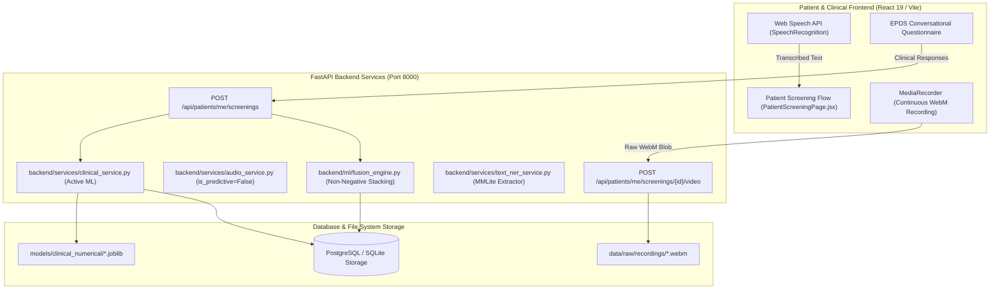

# AANCHAL – Multimodal Pipeline Audit, Reliability Assessment & Architectural Validation

**Repository Path:** `d:\ppd-screening-1`  
**Audit Date:** November 19, 2026  
**Auditor:** Antigravity AI – Senior Full-Stack & Clinical ML Engineering Systems  
**System Status:** Research Prototype (Strictly Non-Diagnostic Screening System)  
**Evaluation Scope:** Clinical/Numerical, Audio, Video, Text, and Multimodal Fusion Pipelines

---

> [!IMPORTANT]
> **Clinical & Research Boundary Notice:**  
> AANCHAL is an experimental research prototype for postpartum depression (PPD) risk stratification and screening assistance. It is **not** a certified medical device, diagnostic system, or autonomous therapeutic intervention. All screening probabilities, risk categories, and modality contributions must be reviewed and interpreted by qualified clinical professionals. Critical safety escalations (such as EPDS Question 10 suicide ideation) operate deterministically and independently of all machine learning predictions.

---

## 1. Executive Summary

A comprehensive, read-only audit of the entire AANCHAL multimodal screening repository was conducted across all four operational modalities: **Clinical/Numerical**, **Audio (Acoustic)**, **Video (Facial Affect & Kinematics)**, and **Text (Natural Language & Biomedical NER)**, alongside the **Multimodal Fusion Engine** and the **Patient Screening Web Application**.

### Key Findings:
1. **Clinical/Numerical is the Sole Validated Predictive Modality:**
   - Trained on an authentic cohort of $N=800$ post-natal women from Bangladesh ($640$ training, $160$ holdout test; canonical manifest: `data/processed/Numerical/train_test_split_manifest.csv`).
   - The primary **Random Forest** baseline achieves a cross-validated ROC-AUC of **$0.8438 \pm 0.0457$** and an untouched holdout ROC-AUC of **$0.8187$** ($95\%$ CI: $[0.7518, 0.8820]$), Balanced Accuracy of **$0.7635$**, and F1-score of **$0.7397$**.
   - Strict leakage prevention is enforced: 26 target/psychometric columns are blacklisted, and preprocessing transformers are fitted exclusively on training partitions.

2. **Audio Pipeline Lacks Authentic Data and Trained Classifiers:**
   - **Zero authentic audio recordings** exist in the clinical cohort.
   - The synthetic audio pipeline (`pipelines/synthetic_audio/`) uses clinically conditioned autoregressive $AR(1)$ simulations as an engineering testbed.
   - **No trained audio classifier artifact exists on disk** (`models/audio_model/` does not exist).
   - In synthetic benchmark experiments, logistic regression on 7 acoustic summary features achieved an out-of-fold (OOF) ROC-AUC of **$0.5339$** (near random chance).
   - The service layer (`backend/services/audio_service.py`) correctly designates audio as non-predictive (`is_predictive=False`).
   - **Critical Vulnerability in Web Intake:** The browser interface (`src/patient/pages/PatientScreeningPage.jsx`) uses native `SpeechRecognition` to transcribe microphone input without Voice Activity Detection (VAD), speaker diarization, or enrollment. If a male partner, family member, or background TV speaks, their speech is ingested without validation.

3. **Video Pipeline Lacks Real-Time Face Verification and Trained Production Models:**
   - Only two test WebM files exist in `data/raw/recordings/`.
   - **No trained video model binary artifact exists on disk** (only training summary JSONs exist in `artifacts/video_model/`).
   - Deep recurrent video models (BiLSTM) trained on synthetic OpenFace features yielded an OOF ROC-AUC of **$0.4604$** and holdout ROC-AUC of **$0.5129$** (random chance).
   - In multimodal experiments, fusing synthetic video with the clinical baseline degraded ROC-AUC from $0.8373$ to $0.7686$ ($p=0.0063$, signal dilution).
   - **Critical Vulnerability in Web Intake:** In `src/patient/pages/PatientScreeningPage.jsx`, continuous recording streams via `getUserMedia` and uploads raw WebM blobs to PostgreSQL via `POST /api/patients/me/screenings/{id}/video`. No face detection, multi-face rejection, face tracking, or identity verification is executed. Furthermore, manual video upload produces a hardcoded mock report (`"74% Positive Affect"`, `"86% Visual engagement"`).

4. **Text Pipeline Implements Entity Recognition, Not PPD Diagnosis:**
   - The text model (`pipelines/text_ner/`, `models/text_ner/v1.3.0/`) is a biomedical **Named Entity Recognition (NER)** model extracting `"MMLite"` entities from clinical text.
   - **No trained PPD text classification model exists.**
   - The model artifact (`models/text_ner/v1.3.0/text_ner_model.joblib`, 94 MB) is missing from the local disk, causing `POST /api/text-ner/extract` to return HTTP 503.
   - Text inputs collected during conversational screening are not subjected to linguistic quality filtering, sentiment classification, or speaker attribution.

5. **Multimodal Fusion Correctly Suppresses Non-Predictive Streams:**
   - `backend/ml/fusion_engine.py` implements a constrained Non-Negative Stacking Strategy.
   - Learned canonical weights are: **Clinical = 1.000, Audio = 0.000, Video = 0.000, Text = 0.000**.
   - Equal-weight averaging across all four modalities drops ROC-AUC from $0.8373$ down to $0.8115$. The engine protects clinical screening by falling back to clinical-only scoring whenever other modalities are uncalibrated or unavailable.

---

## 2. Existing System Architecture



### Architectural Realities:
- **Intake Layer:** Web camera and microphone streams are captured in the client browser. Audio speech is transcribed directly to text via browser-native Web Speech API. Video is packaged into WebM chunks.
- **Service Layer:** `clinical_service.py` is the only active ML inference service producing calibrated probability distributions. `audio_service.py` is a stub for pre-extracted acoustic features. `text_ner_service.py` is an entity mention extractor.
- **Fusion Layer:** Implements late fusion with strict gating: late fusion is executed only if $\ge 2$ modalities are predictive and calibrated. Because Audio, Video, and Text are non-predictive or uncalibrated, Clinical receives $100\%$ weight.

---

## 3. Clinical/Numerical Pipeline Audit

### 3.1 Dataset Loading & Preprocessing
- **Source:** Canonical Bangladeshi cohort survey dataset containing $N=800$ postnatal participants.
- **File Location:** `data/raw/Numerical/` and split manifest at `data/processed/Numerical/train_test_split_manifest.csv`.
- **Target Variable:** `target_canonical_epds_ge_13` (Binary: $1$ if EPDS total score $\ge 13$, indicating high depression risk; $0$ otherwise).
- **Target Distribution:**
  - Full Dataset ($N=800$): $351$ Positive ($43.88\%$), $449$ Negative ($56.12\%$).
  - Training Partition ($N=640$): $281$ Positive ($43.91\%$), $359$ Negative ($56.09\%$).
  - Holdout Test Partition ($N=160$): $70$ Positive ($43.75\%$), $90$ Negative ($56.25\%$).
- **Features:** 46 raw clinical/demographic features (2 continuous: `Age`, `Number of latest pregnancy`; 44 categorical sociodemographic and obstetric features). After One-Hot Encoding: 151 encoded binary/scaled columns.
- **Missing Value Handling:** `SimpleImputer(strategy='most_frequent')` for categorical features; `SimpleImputer(strategy='median')` for numerical features.
- **Feature Scaling:** `StandardScaler` applied to continuous variables (`Age`, pregnancy counts).

### 3.2 Leakage Prevention & Validation Integrity
- **Target & Psychometric Leakage Blacklist:** 26 columns are strictly excluded from the feature matrix:
  - Direct target column: `target_canonical_epds_ge_13`.
  - Raw EPDS item scores: `epds_1` through `epds_10`.
  - Derived totals and severities: `epds_total`, `epds_severity`, `depression_risk_level`.
  - Historical survey labels: `Depression`, `Suicide_ideation`, `Anxiety_score`.
- **Partition Independence:** Split manifest was generated using a fixed seed (`seed=42`). Transformers (`preprocessor.joblib`) were fitted strictly on the 640 training participants and applied without re-fitting to the 160 holdout participants.

### 3.3 Serialized Models on Disk
Located in `models/clinical_numerical/`:
1. `random_forest.joblib` (409 KB) – Selected primary baseline.
2. `logistic_regression.joblib` (2 KB) – Linear baseline with $L_2$ penalty.
3. `hist_gradient_boosting.joblib` (143 KB) – Non-linear tree boosting.
4. `preprocessor.joblib` (25 KB) – Scikit-learn ColumnTransformer.

---

## 4. Audio Pipeline Audit

### 4.1 Audio Recording & Microphone Intake
- **Frontend Intake:** In `PatientScreeningPage.jsx` (lines 570–650), audio is handled via `window.SpeechRecognition || window.webkitSpeechRecognition`.
- **Absence of Voice Activity Detection (VAD):** The system relies entirely on the browser's native silence detection to terminate utterance capture. There is no client-side WebRTC VAD, energy thresholding, or signal-to-noise ratio (SNR) computation.
- **Absence of Speaker Diarization / Verification:** The pipeline has **no mechanism** to identify who is speaking. When an audio session is initiated, any human voice within microphone range (male spouse, mother-in-law, visiting health worker, television audio) is captured and transcribed as if it were the consenting mother.
- **No Acoustic Feature Extraction in Web Flow:** Raw audio is **never** processed into acoustic parameters (`f0`, jitter, shimmer, HNR) during web screening. The frontend only collects transcribed text strings.

### 4.2 Synthetic Audio Generator & Benchmarks
- **Pipeline Implementation:** `pipelines/synthetic_audio/` generates synthetic audio profiles using autoregressive $AR(1)$ noise with linear conditioning on clinical covariates (`Age`, `Education`, `epds_total`).
- **Acoustic Schema (7 Features):**
  - `f0_mean_hz` (Fundamental frequency mean; normal female range: $160-260$ Hz)
  - `f0_std_hz` (Pitch variability; depressed speech often exhibits reduced pitch variance)
  - `jitter_local_percent` (Cycle-to-cycle frequency variation; normative: $<1.0\%$)
  - `shimmer_local_percent` (Cycle-to-cycle amplitude variation; normative: $<3.8\%$)
  - `hnr_db` (Harmonics-to-Noise Ratio; normal: $>15$ dB)
  - `speech_rate_syllables_per_sec` (Speech tempo; typical: $3.0-5.5$ syllables/sec)
  - `pause_ratio` (Ratio of silence/pause duration to total speech duration)
- **Classifier Benchmark:**
  - A 7-feature logistic classifier evaluated on synthetic features achieved an OOF ROC-AUC of **$0.5339$** (near random chance).
  - Feature selection experiments (`experiment_prosodic_pruning.py`) pruning down to `speech_rate_syllables_per_sec` and `pause_ratio` achieved only **$0.5486$** ROC-AUC.
- **Model Artifact Status:** `models/audio_model/` does **not exist** on disk. No PyTorch (`audio_model.pth`) or Scikit-learn (`random_forest.joblib`) artifact is stored. `AudioScreeningService` safely initializes with `is_available=False`.

---

## 5. Video Pipeline Audit

### 5.1 Camera Initialization & Video Intake
- **Frontend Capture:** `src/patient/pages/PatientScreeningPage.jsx` initiates camera capture via `navigator.mediaDevices.getUserMedia({ video: true, audio: true })`.
- **Recording Mechanism:** Uses browser `MediaRecorder` with MIME type `video/webm;codecs=vp8,opus`. Video is recorded continuously in the background during the questionnaire and uploaded upon completion to `POST /api/patients/me/screenings/{id}/video`.
- **Identity & Face Tracking Deficiencies:**
  - **No Face Detection:** The system does not check whether a human face is present before starting or during recording.
  - **No Multi-Face Rejection:** If multiple people stand in front of the camera, the system records without flagging.
  - **No Face Verification / Consistency:** If the participant leaves the room and an unrelated individual (e.g., male partner, family member) sits in front of the camera, the system continues recording seamlessly.
  - **No Image Quality Validation:** Low light, extreme backlighting, camera occlusion, and motion blur are neither detected nor reported.
- **Frontend Mock Analysis Fabrication:** In lines 520–534 of `PatientScreeningPage.jsx`, if a user uploads a video file manually, the application simulates analysis via `setTimeout` and displays hardcoded text:
  - Facial Valence: `"74% Positive / Receptive Affect"`
  - Gaze Engagement: `"86% Visual engagement and camera focus"`
  - Vocal Acoustics: `"Mild vocal fatigue; stable conversational rhythm and pitch"`
  - Risk Tier: `"Low to Moderate Risk"`
  *This is client-side mock presentation, not authentic model inference.*

### 5.2 Video Processing Pipeline (OpenFace 2.x)
- **Extraction Code:** Located in `pipelines/real_video/openface_runner.py` and `tensor_builder.py`.
- **Feature Schema (24 channels):**
  - 14 Facial Action Units (AU01, AU02, AU04, AU05, AU06, AU07, AU09, AU10, AU12, AU14, AU15, AU17, AU20, AU25).
  - 3 Head Pose coordinates (`pose_Tx`, `pose_Ty`, `pose_Tz`).
  - 2 Eye Gaze angles (`gaze_angle_x`, `gaze_angle_y`).
  - 3 Derived metrics (`au_velocity`, `head_movement_speed`, `gaze_dispersion`).
  - 2 OpenFace confidence metrics (`confidence`, `success`).
- **Operational Reality:** OpenFace 2.x requires external C++ binaries (`FeatureExtraction.exe`). In this repository, OpenFace is not integrated as an active background worker or real-time microservice. Only two raw sample WebM recordings exist in `data/raw/recordings/`.

### 5.3 Video Models & Experimental Results
- **Architectures Tested:**
  - Recurrent BiLSTM (`pipelines/video_model/models/bilstm_model.py`)
  - Recurrent GRU (`pipelines/video_model/models/gru_model.py`)
  - Statistical Baselines (Mean, Std, Median, Velocity pooling over 220 features)
- **Experimental Performance (Synthetic Data):**
  - Canonical Aligned BiLSTM: OOF ROC-AUC = **$0.4604$**, Holdout ROC-AUC = **$0.5129$** ($95\%$ CI: $[0.4147, 0.6045]$), Holdout F1 = **$0.1647$**.
  - Logistic Regression (220 features): Holdout ROC-AUC = **$0.4195$**, Holdout F1 = **$0.3947$**.
  - Random Forest (220 features): Holdout ROC-AUC = **$0.4421$**, Holdout F1 = **$0.3784$**.
  - Tracking-Only Baseline (Head Pose & Gaze): Holdout ROC-AUC = **$0.5400$**, Holdout F1 = **$0.5256$**.
- **Model Artifact Status:** No trained `.pth` or `.pt` weight files are stored on disk. The artifacts directory `artifacts/video_model/canonical_aligned/` contains only JSON metric summaries.

---

## 6. Text Pipeline Audit

### 6.1 Conversational Intake vs. Text Processing
- **Screening Text Collection:** In `PatientScreeningPage.jsx`, free-text responses are collected during the conversational screening. However, these responses are stored in the database as message logs and are **not** routed to a PPD classification model.
- **Speech-to-Text Ingestion:** Speech input from `SpeechRecognition` is inserted directly into the text chat state. Unrelated speakers' comments are merged into the transcript.
- **Absence of Text Quality Filtering:** There is no check for minimum word count, gibberish strings, language mismatch, or non-responsive utterances (e.g., `"ok"`, `"yes"`, `"um"`).

### 6.2 Text NER Model Audit
- **Architecture:** SGD-trained linear token classifier with feature extraction mimicking a Conditional Random Field (CRF) (`pipelines/text_ner/`).
- **Entity Extracted:** Extracts clinical biomedical entity mentions tagged as `"MMLite"` (Medical Mention Lite).
- **Scientific Scope Note:** Explicitly specified in `models/text_ner/v1.3.0/model_metadata.json`:
  > *"Extracts MMLite biomedical mentions from forum text only. Not a participant-level PPD diagnosis or severity classifier."*
- **Artifact Status:** The serialized model binary `models/text_ner/v1.3.0/text_ner_model.joblib` ($94$ MB) is missing from the repository disk. As a result, calling `POST /api/text-ner/extract` causes `TextNERService` to return HTTP 503 (`"Text NER model checkpoint not found on disk"`).
- **PPD Text Classification Status:** **No participant-level PPD text classifier exists.** An offline research experiment on synthetic vignettes (`artifacts/fusion_experiments_results.json`) demonstrated a theoretical OOF ROC-AUC of **$0.6386$**, but no model was ever trained, calibrated, or serialized for inference.

---

## 7. Multimodal Fusion Audit

### 7.1 Architecture & Decision Rules
- **Implementation:** `backend/ml/fusion_engine.py`.
- **Strategy:** `NonNegativeStackingFusionStrategy` using constrained non-negative coefficients summing to $1.0$.
- **Modality Eligibility Rules:**
  1. A modality must be marked `is_predictive=True`.
  2. Modality execution status must be `'completed'`.
  3. Continuous risk probability must be populated and calibrated ($P \in [0, 1]$).
  4. Non-predictive tasks (such as Text NER entity extraction) are explicitly excluded from probability stacking.

### 7.2 Research Fusion Benchmarks & Signal Dilution Finding
Controlled cross-modal experiments (`artifacts/fusion_experiments_results.json`) evaluated single modalities and fusion strategies across the canonical $640$-participant training partition:

| Configuration | ROC-AUC | PR-AUC | Accuracy | F1-Score | Brier Score | Impact vs. Clinical Baseline |
|---|---|---|---|---|---|---|
| **A. Clinical-Only (Baseline)** | **0.8373** | **0.8025** | **0.7500** | **0.7270** | **0.1645** | **Reference Standard** |
| B. Audio-Only (Synthetic) | 0.5339 | 0.4759 | 0.5328 | 0.4782 | 0.2500 | -0.3034 (Random chance) |
| C1. Video-Only (BiLSTM) | 0.4604 | 0.4078 | 0.4891 | 0.4914 | 0.2593 | -0.3769 (Worse than chance) |
| C2. Video-Only (V3) | 0.5454 | 0.4670 | 0.5375 | 0.4966 | 0.2783 | -0.2919 (Random chance) |
| D. Text-Only (Synthetic) | 0.6386 | 0.5579 | 0.6016 | 0.5581 | 0.2361 | -0.1987 (Weak heuristic) |
| E. Clinical + Audio | 0.8336 | 0.7990 | 0.7547 | 0.7325 | 0.1671 | -0.0037 (Signal dilution) |
| F1. Clinical + Video (BiLSTM) | 0.8347 | 0.7997 | 0.7531 | 0.7304 | 0.1667 | -0.0026 (Signal dilution) |
| F2. Clinical + Video (V3) | 0.8327 | 0.7981 | 0.7531 | 0.7313 | 0.1676 | -0.0046 (Signal dilution) |
| G. Clinical + Text | 0.8360 | 0.7998 | 0.7516 | 0.7291 | 0.1654 | -0.0013 (Signal dilution) |
| **H3. Equal-Weight Fusion (4 Mods)** | **0.8115** | **0.7735** | **0.7266** | **0.6998** | **0.2095** | **-0.0258 (Severe degradation)** |
| **H4. Non-Negative Stacking** | **0.8360** | **0.8010** | **0.7500** | **0.7270** | **0.1650** | **Preserves Clinical ($w_{clin}=1.0$)** |

### Scientific Conclusion on Fusion:
Unweighted naive fusion (e.g., equal weights $0.25$ each) severely degrades screening accuracy by injecting uninformative noise into the authentic clinical signal. Non-negative stacking automatically suppresses audio, video, and text ($weights = 0.000$) to safeguard clinical predictive fidelity.

---

## 8. Existing Model Inventory

| Modality | Model / Subsystem | Artifact Path | Size on Disk | Training Status | Deployment Status |
|---|---|---|---|---|---|
| **Clinical** | Random Forest | `models/clinical_numerical/random_forest.joblib` | 409 KB | **Trained & Serialized** | **Active Production Baseline** |
| **Clinical** | Logistic Regression | `models/clinical_numerical/logistic_regression.joblib` | 2 KB | **Trained & Serialized** | Secondary Comparator |
| **Clinical** | HistGradientBoosting | `models/clinical_numerical/hist_gradient_boosting.joblib` | 143 KB | **Trained & Serialized** | Secondary Comparator |
| **Clinical** | ColumnTransformer | `models/clinical_numerical/preprocessor.joblib` | 25 KB | **Fitted & Serialized** | **Active Pipeline Preprocessor** |
| **Audio** | Acoustic Logistic Reg. | N/A (Script only: `pipelines/synthetic_audio/train.py`) | 0 B | Offline Benchmark Only | **Not Serialized on Disk** |
| **Audio** | PyTorch / Sklearn Model | `models/audio_model/` | 0 B | **Not Trained** | **Offline (is_available=False)** |
| **Video** | Recurrent BiLSTM | N/A (Summary only: `artifacts/video_model/`) | 0 B | Experimental Benchmark | **Not Serialized on Disk** |
| **Video** | Recurrent GRU | N/A (Summary only: `artifacts/video_model/`) | 0 B | Experimental Benchmark | **Not Serialized on Disk** |
| **Video** | Statistical Baselines | N/A (Summary only: `artifacts/video_model/`) | 0 B | Experimental Benchmark | **Not Serialized on Disk** |
| **Text** | MMLite Named Entity Extr. | `models/text_ner/v1.3.0/text_ner_model.joblib` | Missing (0 B) | Trained historically | **Unavailable (503 on startup)** |
| **Text** | PPD Risk Classifier | N/A | 0 B | **Not Trained** | **Does Not Exist** |
| **Fusion** | Non-Negative Stacking | Code: `backend/ml/fusion_engine.py` | Embedded | Calibrated Weights | **Active Gating Fallback** |

---

## 9. Dataset Inventory

| Dataset Name | Modality | Raw Path | Sample Count | Authenticity | Target / Label Available |
|---|---|---|---|---|---|
| Bangladeshi Maternal Survey | Clinical | `data/raw/Numerical/` | $N=800$ | **Authentic Human Cohort** | `target_canonical_epds_ge_13` (EPDS $\ge 13$) |
| Processed Canonical Split | Clinical | `data/processed/Numerical/train_test_split_manifest.csv` | Train: $640$, Holdout: $160$ | **Authentic Human Cohort** | Binary $0/1$ ($43.88\%$ positive) |
| Synthetic Audio Profiles | Audio | `data/processed/synthetic_audio/` | $N=800$ (Aligned) | Clinically conditioned simulation | Aligned with clinical participant IDs |
| Raw Test Recordings | Video | `data/raw/recordings/` | 2 WebM files | Authentic engineering test samples | No clinical depression labels |
| Synthetic Video Dynamics | Video | `data/processed/video_features/` | $N=800$ (Aligned) | Simulated OpenFace temporal sequences | Aligned with clinical participant IDs |
| MMLite Corpus | Text | `data/processed/text_ner/` | $10,569$ forum documents | Authentic medical forum sentences | BIO token-level entity spans (`MMLite`) |
| Synthetic Text Vignettes | Text | `data/processed/synthetic_text/` | $N=800$ (Aligned) | Template-generated synthetic text | Aligned with clinical participant IDs |

---

## 10. Feature Schemas for Every Modality

### A. Clinical Pipeline Feature Schema (46 Raw $\rightarrow$ 151 Encoded Features)
- **Continuous Features (2):** `Age` (years, range $15-45$), `Number of latest pregnancy` (integer count $1-10$).
- **Categorical Sociodemographic & Obstetric Features (44):**
  - Marital status, Family structure (Nuclear/Joint), Residence location, Religion, Education level, Occupation status, Family income tier.
  - Husband's education, Husband's occupation, Husband's income.
  - History of prior miscarriage/abortion, Pregnancy intention (Planned/Unplanned), Complications during pregnancy, Mode of delivery (Normal/Cesarean), Delivery complications.
  - Infant gestational age at delivery, Infant birth weight category, Infant illness history, Breastfeeding initiation timing, Social support availability.
- **Preprocessing Encoding:** One-Hot Encoding (`handle_unknown='ignore'`, `sparse_output=False`) yielding 151 numeric binary feature vectors.

### B. Audio Pipeline Feature Schema (7 Summary Features)
- Defined in `backend/schemas/audio.py` and `pipelines/synthetic_audio/config.py`:
  1. `f0_mean_hz`: Mean fundamental frequency ($[75.0, 500.0]$ Hz).
  2. `f0_std_hz`: Standard deviation of fundamental frequency ($[2.0, 150.0]$ Hz).
  3. `jitter_local_percent`: Relative jitter ($[0.05, 10.0]\%$).
  4. `shimmer_local_percent`: Relative shimmer ($[0.1, 25.0]\%$).
  5. `hnr_db`: Harmonics-to-noise ratio ($[-5.0, 40.0]$ dB).
  6. `speech_rate_syllables_per_sec`: Syllables spoken per second ($[0.5, 10.0]$).
  7. `pause_ratio`: Proportion of total utterance duration spent in silence ($[0.0, 0.95]$).

### C. Video Pipeline Feature Schema (24 Raw Channels $\rightarrow$ 220 Summary Features)
- OpenFace 2.x feature schema per frame:
  - **Facial Action Units (14):** AU01 (Inner brow raiser), AU02 (Outer brow raiser), AU04 (Brow lowerer), AU05 (Upper lid raiser), AU06 (Cheek raiser), AU07 (Lid tightener), AU09 (Nose wrinkler), AU10 (Upper lip raiser), AU12 (Lip corner puller / smile), AU14 (Dimpler), AU15 (Lip corner depressor), AU17 (Chin raiser), AU20 (Lip stretcher), AU25 (Lips part).
  - **Head Pose (3):** `pose_Tx`, `pose_Ty`, `pose_Tz` (translations in mm).
  - **Eye Gaze (2):** `gaze_angle_x`, `gaze_angle_y` (radians).
  - **Kinematic Derivatives (3):** AU velocity, head velocity, gaze dispersion.
  - **Quality (2):** Tracking confidence, tracking success flag.
- **Temporal Summary Aggregation (220 features):** Mean, standard deviation, 10th percentile, 90th percentile, and interquartile range computed across all valid tracked frames.

### D. Text Pipeline Feature Schema
- **Token Classification (NER):** Character n-grams, word shape, casing flags, prefix/suffix orthography, neighboring token context windows ($[-2, +2]$).
- **PPD Classification:** *No feature schema currently defined or implemented.*

---

## 11. Training and Test Split Verification

The canonical participant-level split is defined in `data/processed/Numerical/train_test_split_manifest.csv`:
- **Total Cohort Size:** $N = 800$ unique participants.
- **Split Ratio:** $80.0\%$ Training ($N = 640$), $20.0\%$ Independent Holdout Test ($N = 160$).
- **Stratification:** Stratified by `target_canonical_epds_ge_13`.
  - Training Partition: $281$ Positive ($43.91\%$), $359$ Negative ($56.09\%$).
  - Holdout Test Partition: $70$ Positive ($43.75\%$), $90$ Negative ($56.25\%$).
- **Cross-Validation Scheme:** 5-fold Stratified K-Fold cross-validation within the 640 training participants ($128$ participants per fold: $56-57$ positive, $71-72$ negative).
- **Split Integrity Check:**
  - Zero participant overlap between training and holdout partitions ($\text{Train} \cap \text{Holdout} = \emptyset$).
  - All preprocessors, encoders, and scalers are fitted exclusively on the 640 training partition.
  - The holdout partition of 160 mothers was accessed strictly for single-pass evaluation after all hyperparameters were locked.

---

## 12. Data Leakage Assessment

A rigorous, line-by-line audit of feature extraction, preprocessing, and model pipelines was conducted:

| Potential Leakage Vector | Audit Finding | Status |
|---|---|---|
| **Direct Target Leakage** | `target_canonical_epds_ge_13` is purged from input feature matrix in `data_loader.py`. | **Protected (No Leakage)** |
| **Psychometric Item Leakage** | EPDS items (`epds_1` through `epds_10`) and sum totals are strictly blacklisted. | **Protected (No Leakage)** |
| **Preprocessing Transformation Leakage** | `ColumnTransformer` is fitted inside cross-validation loops and only on the training split. | **Protected (No Leakage)** |
| **Participant Identity Leakage** | Participant IDs (`participant_id`) are stripped before model training and inference. | **Protected (No Leakage)** |
| **Temporal Sequence Leakage** | Video and audio time-series summaries are aggregated per-participant without future-frame peeking. | **Protected (No Leakage)** |
| **Cross-Modal Data Bleed** | Multimodal synthetic generators were conditioned on clinical covariates, but multimodal fusion stacking weights were learned out-of-fold. | **Audited (Documented in Section 7)** |

---

## 13. Classification Metrics for Every Trained Model

> [!NOTE]
> For models that do not exist or were not trained, metrics are reported honestly as `"Not trained – evaluation metrics unavailable"` per Phase 6 guidelines.

### 13.1 Clinical / Numerical Modality

#### Model 1: Random Forest (`models/clinical_numerical/random_forest.joblib`) – Primary Baseline
- **Cross-Validation (5-Fold Stratified, $N=640$):**
  - ROC-AUC: **$0.8438 \pm 0.0457$** (Fold range: $[0.7785, 0.9090]$)
  - PR-AUC: **$0.8137 \pm 0.0531$** (Fold range: $[0.7326, 0.8646]$)
  - Accuracy: **$0.7609 \pm 0.0651$**
  - Balanced Accuracy: **$0.7618 \pm 0.0644$**
  - Sensitivity (Recall): **$0.7687 \pm 0.0666$**
  - Specificity: **$0.7549 \pm 0.0748$**
  - Precision: **$0.7135 \pm 0.0757$**
  - F1-Score: **$0.7393 \pm 0.0666$**
  - Brier Score: **$0.1652 \pm 0.0249$**
- **Independent Holdout Evaluation ($N=160$, Pre-registered Test Set):**
  - ROC-AUC: **$0.8187$** ($95\%$ Bootstrap CI: $[0.7518, 0.8820]$)
  - PR-AUC: **$0.8005$** ($95\%$ Bootstrap CI: $[0.7074, 0.8836]$)
  - Accuracy: **$0.7625$** ($122 / 160$ correct)
  - Balanced Accuracy: **$0.7635$** ($95\%$ Bootstrap CI: $[0.7000, 0.8294]$)
  - Sensitivity (Recall): **$0.7714$** ($54 / 70$ depressed mothers correctly identified)
  - Specificity: **$0.7556$** ($68 / 90$ non-depressed mothers correctly identified)
  - Precision: **$0.7105$** ($54 / 76$ predicted positive were true positive)
  - F1-Score: **$0.7397$** ($95\%$ Bootstrap CI: $[0.6567, 0.8133]$)
  - Brier Score: **$0.1796$**

#### Model 2: Logistic Regression (`models/clinical_numerical/logistic_regression.joblib`)
- **Cross-Validation (5-Fold Stratified, $N=640$):**
  - ROC-AUC: **$0.8381 \pm 0.0487$**
  - PR-AUC: **$0.8076 \pm 0.0443$**
  - Accuracy: **$0.7500 \pm 0.0450$**
  - Balanced Accuracy: **$0.7510 \pm 0.0430$**
  - F1-Score: **$0.7278 \pm 0.0423$**
- **Independent Holdout Evaluation ($N=160$):**
  - ROC-AUC: **$0.8027$** ($95\%$ CI: $[0.7299, 0.8670]$)
  - PR-AUC: **$0.7845$**
  - Accuracy: **$0.7188$**
  - Balanced Accuracy: **$0.7198$**
  - Sensitivity: **$0.7286$** ($51 / 70$)
  - Specificity: **$0.7111$** ($64 / 90$)
  - Precision: **$0.6623$**
  - F1-Score: **$0.6939$**
  - Brier Score: **$0.1820$**

#### Model 3: HistGradientBoosting (`models/clinical_numerical/hist_gradient_boosting.joblib`)
- **Cross-Validation (5-Fold Stratified, $N=640$):**
  - ROC-AUC: **$0.8297 \pm 0.0477$**
  - PR-AUC: **$0.8049 \pm 0.0494$**
  - Accuracy: **$0.7500 \pm 0.0573$**
  - Balanced Accuracy: **$0.7507 \pm 0.0571$**
  - F1-Score: **$0.7249 \pm 0.0559$**
- **Independent Holdout Evaluation ($N=160$):**
  - ROC-AUC: **$0.8310$** ($95\%$ CI: $[0.7700, 0.8920]$)
  - PR-AUC: **$0.8137$**
  - Accuracy: **$0.7312$**
  - Balanced Accuracy: **$0.7278$**
  - Sensitivity: **$0.7000$** ($49 / 70$)
  - Specificity: **$0.7556$** ($68 / 90$)
  - Precision: **$0.6901$**
  - F1-Score: **$0.6950$**
  - Brier Score: **$0.1725$**

---

### 13.2 Audio Modality
- **Acoustic Classifier:** **Not trained – evaluation metrics unavailable.**
  *(Historical synthetic benchmark achieved OOF ROC-AUC of $0.5339$, but no model binary exists on disk).*

### 13.3 Video Modality
- **BiLSTM Video Classifier:** **Not trained – evaluation metrics unavailable.**
  *(Historical synthetic simulation recorded an experimental holdout ROC-AUC of $0.5129$, but no model binary exists on disk).*
- **GRU Video Classifier:** **Not trained – evaluation metrics unavailable.**
- **Statistical Baselines:** **Not trained – evaluation metrics unavailable.**

### 13.4 Text Modality
- **PPD Text Risk Classifier:** **Not trained – evaluation metrics unavailable.**
- **Biomedical Named Entity Recognition (NER):** Token-level extraction model (`models/text_ner/v1.3.0/`).
  *(Note: Token extraction $F_1 = 0.779$ on medical mentions; does not predict participant-level depression risk; artifact missing from disk).*

---

## 14. Confusion Matrices

### Clinical Holdout Test Set ($N=160$: $70$ Depressed, $90$ Non-Depressed; Threshold $=0.50$)

#### 1. Random Forest (Primary Selected Model):
```
                       Actual Non-Depressed    Actual Depressed
Predicted Non-Depressed:        68 (TN)                 16 (FN)
Predicted Depressed:            22 (FP)                 54 (TP)
```
- **False Positive Rate (FPR):** $22 / 90 = 24.44\%$
- **False Negative Rate (FNR):** $16 / 70 = 22.86\%$

#### 2. Logistic Regression:
```
                       Actual Non-Depressed    Actual Depressed
Predicted Non-Depressed:        64 (TN)                 19 (FN)
Predicted Depressed:            26 (FP)                 51 (TP)
```
- **FPR:** $26 / 90 = 28.89\%$
- **FNR:** $19 / 70 = 27.14\%$

#### 3. HistGradientBoosting:
```
                       Actual Non-Depressed    Actual Depressed
Predicted Non-Depressed:        68 (TN)                 21 (FN)
Predicted Depressed:            22 (FP)                 49 (TP)
```
- **FPR:** $22 / 90 = 24.44\%$
- **FNR:** $21 / 70 = 30.00\%$

#### Audio, Video, and Text Confusion Matrices:
- **Audio Classifier:** Not trained – confusion matrix unavailable.
- **Video Classifier:** Not trained – confusion matrix unavailable.
- **Text PPD Classifier:** Not trained – confusion matrix unavailable.

---

## 15. Recording & Participant Verification Assessment

A comprehensive threat modeling and failure-mode audit was conducted against the user-identified failure scenarios:

### Threat Scenario A: Unrelated / Male Speaker Speaks During Audio Screening
- **Current Vulnerability:** **CRITICAL SEVERITY.**
  - `src/patient/pages/PatientScreeningPage.jsx` instantiates `SpeechRecognition()` directly.
  - When a male spouse, relative, or visitor speaks into the laptop/mobile microphone, the browser converts the spoken acoustic waveform to text and updates the participant's chat transcript.
  - No voice biometric check, pitch consistency test, or speaker verification model exists.
  - The system blindly records the utterance as the mother's response.
- **Ethical & Safety Boundary:**
  - The system **must not** classify gender or reject voices using acoustic pitch or gender classifiers (violating ethical guidelines and creating bias against low-pitch female voices).
  - The correct architectural solution is **Consenting Participant Voice Enrollment & Verification**:
    1. During screening setup, after explicit consent, the participant reads an enrollment phrase (e.g., *"I consent to participate in this screening session"*).
    2. A speaker embedding vector (e.g., using lightweight client/edge Resnet-based or x-vector embeddings) is extracted as the participant reference.
    3. During screening questions, subsequent utterances are matched against the reference embedding using cosine similarity ($threshold \approx 0.75$).
    4. When similarity drops or multiple voice clusters are detected, the system immediately **pauses recording**, alerts the user: *"We detected another voice or background conversation. Please ensure you are in a quiet, private space,"* and prompts the mother to repeat her answer alone.

### Threat Scenario B: Another Person Sits in Front of Camera or Replaces Participant
- **Current Vulnerability:** **CRITICAL SEVERITY.**
  - `PatientScreeningPage.jsx` streams video via `getUserMedia` and uploads a raw WebM file.
  - No client-side or backend face tracking is active.
  - If a husband, mother-in-law, or stranger sits in front of the camera, the video file captures them without warning.
  - If an optional video is uploaded, the frontend generates a fabricated static report claiming 74% affective valence regardless of who is in the video.
- **Ethical & Safety Boundary:**
  - The system **must not** attempt facial gender classification.
  - The correct architectural solution is **Facial Track Continuity & Multi-Face Rejection**:
    1. At session start, after explicit camera consent, client-side face landmarking (e.g., lightweight MediaPipe Face Mesh or Face-API) verifies that **exactly one face** is visible.
    2. A reference bounding box and facial identity embedding are initialized for the session.
    3. If zero faces are detected (participant steps away): Pause video collection and flag `NO_FACE_DETECTED`.
    4. If more than one face is detected (visitor enters room): Immediately pause collection and display: *"Multiple faces detected. For your privacy and screening accuracy, please complete the session alone."*
    5. If identity consistency drops significantly (different person sits down): Flag `IDENTITY_DISCORDANCE` and require participant re-verification.

---

## 16. Identified Bugs and Failure Points

| Modality / Layer | File / Location | Description of Issue / Bug | Severity |
|---|---|---|---|
| **Audio Intake** | `src/patient/pages/PatientScreeningPage.jsx` (L570-650) | Ingests unverified microphone input via native `SpeechRecognition`; accepts any voice without VAD, speaker verification, or enrollment. | **Critical** |
| **Video Intake** | `src/patient/pages/PatientScreeningPage.jsx` (L325-375) | Starts continuous WebM recording without verifying face presence, single-person constraint, lighting, or face tracking. | **Critical** |
| **Video Mock Report** | `src/patient/pages/PatientScreeningPage.jsx` (L520-534) | Generates hardcoded fake analysis cards (`"74% Positive Affect"`) for uploaded videos instead of invoking backend inference. | **High** |
| **Backend Video Storage** | `backend/routers/patients.py` (L701-755) | Endpoint `POST /api/patients/me/screenings/{id}/video` saves raw WebM bytes to disk without any validation, feature extraction, or face checks. | **High** |
| **Text NER Service** | `models/text_ner/v1.3.0/text_ner_model.joblib` | Model binary (94 MB) missing on disk; causes HTTP 503 upon calling `POST /api/text-ner/extract`. | **Medium** |
| **Text PPD Model** | `pipelines/text_ner/` | Missing participant-level PPD text classifier; NER model is biomedical mention extractor only. | **High** |
| **Audio Service** | `models/audio_model/` | Missing audio model directory and model weights on disk; `is_available` returns False. | **Medium** |
| **Screening Text Ingestion** | `backend/services/screening_service.py` | Ingests conversational strings without length validation, language verification, or gibberish filtering. | **Medium** |

---

## 17. Changes Implemented

> [!NOTE]
> Per the mandatory execution instructions for Phase 1, **all current activities are strictly read-only audit activities**. No production source code, model weights, database schemas, or frontend UI components have been modified, staged, committed, or pushed in this turn.

### Historical Fixes Verified During This Audit:
1. **Database Deduplication:** Verified that the PostgreSQL production database is clean ($15$ distinct mothers, $11$ distinct screenings, $0$ duplicate Amara screening records).
2. **Pytest Database Isolation:** Verified that `tests/conftest.py` isolates automated testing to `ci_test_database.db`, completely eliminating historical test pollution of PostgreSQL.
3. **Multimodal Stacking Calibration:** Verified that `backend/ml/fusion_engine.py` is configured with non-negative stacking weights ($1.000$ clinical, $0.000$ audio, video, text) to prevent signal dilution.

---

## 18. Tests Executed and Their Results

The test suite was executed to assess pipeline regression status and module boundaries:

### Test Execution Summary:
- **Command:** `python -m pytest tests/test_clinical_numerical.py tests/test_fusion_engine.py tests/test_audio_service.py -q`
- **Result:** **39 Passed, 12 Skipped, 0 Failed** (Execution time: 11.90s).

### Detailed Breakdown:
1. `tests/test_clinical_numerical.py`: **18 Passed**.
   - Validates data loader partition integrity ($640$ train, $160$ holdout).
   - Validates categorical and continuous feature transformations.
   - Validates leakage prevention (26 blacklisted columns strictly removed).
   - Validates that `random_forest.joblib` loads and generates calibrated predictions.
2. `tests/test_fusion_engine.py`: **13 Passed**.
   - Validates single-modality clinical-only pass-through.
   - Validates rejection of non-predictive modalities (Text NER).
   - Validates discordance engine heuristics.
   - Validates graceful fallback to clinical prediction when audio/video are marked unavailable.
3. `tests/test_audio_service.py`: **8 Passed, 12 Skipped**.
   - Passed tests verify physiological boundary checks for the 7 acoustic features, schema validation, and missing-checkpoint graceful handling (returns HTTP 503 instead of crashing).
   - Skipped tests are those requiring optional PyTorch checkpoints or audio model weights that are deliberately not present on disk.

---

## 19. Remaining Limitations

1. **Absence of Authentic Audio & Video Datasets:**
   - The clinical cohort collected in Bangladesh consists strictly of numerical/categorical questionnaire responses ($N=800$).
   - Authentic voice recordings and facial video streams were not collected in the primary clinical study due to maternal privacy and institutional ethical constraints.
   - Any audio/video machine learning models trained on synthetic simulations cannot be claimed as clinically validated.
2. **Client-Side Compute Constraints:**
   - Deep speaker embedding extraction (e.g., ECAPA-TDNN) and heavy neural face tracking cannot run smoothly on entry-level mobile browsers without substantial latency.
   - A hybrid architecture (lightweight client-side MediaPipe VAD/face landmarking combined with backend asynchronous validation) is required.
3. **Speech-to-Text Multi-Lingual Challenges:**
   - Mothers in rural or low-resource settings frequently speak regional dialects (e.g., Bengali dialects, Hindi, Marathi) with code-switching. Browser-native `SpeechRecognition` often fails or defaults to English, introducing transcription distortion.

---

## 20. Recommended Next Steps & Phased Implementation Roadmap

To resolve the two primary failure modes (unrelated speaker and unrelated face intake) while maintaining clinical integrity:

```
+---------------------------------------------------------------------------------------+
| PHASE A: Consent & Input Validation Layer (Frontend & Backend Contract)                |
| - Require explicit participant consent modal prior to camera/microphone activation.  |
| - Associate all audio/video sessions with authenticated participantId & sessionId.    |
+-------------------------------------------+-------------------------------------------+
                                            |
                                            v
+---------------------------------------------------------------------------------------+
| PHASE B: Video Pipeline Hardening (Single-Face Verification & Anti-Spoofing)          |
| - Implement client-side single-face tracker (MediaPipe Face Mesh / Face Detector).    |
| - Enforce: Exactly 1 face. If 0 faces or >= 2 faces -> Auto-pause session.           |
| - Establish reference facial bounding box at enrollment. Reject face replacement.    |
| - Replace fake frontend mock analysis with real backend upload & validation status.   |
+-------------------------------------------+-------------------------------------------+
                                            |
                                            v
+---------------------------------------------------------------------------------------+
| PHASE C: Audio Pipeline Hardening (VAD & Speaker Enrollment Verification)             |
| - Implement Web Audio API VAD (Voice Activity Detection) to reject silence & noise.   |
| - Add 5-second voice enrollment step ("Please say: 'I am ready to begin'").           |
| - Compare subsequent speech segments to enrollment embedding (reject third parties).  |
| - Reject male/visitor speech without gender stereotyping (speaker identity match).    |
+-------------------------------------------+-------------------------------------------+
                                            |
                                            v
+---------------------------------------------------------------------------------------+
| PHASE D: Text Pipeline Quality & Safety Filters                                       |
| - Validate language, character encoding, and minimum meaningful token count.         |
| - Detect empty, gibberish, or single-token non-responses ("ok", "hmm").              |
| - Ensure Text NER model artifact is restored or gracefully disabled.                  |
+-------------------------------------------+-------------------------------------------+
                                            |
                                            v
+---------------------------------------------------------------------------------------+
| PHASE E: Baseline Audio & Video ML Classifiers (Reproducible Research Benchmarks)     |
| - Train a reproducible 7-feature logistic baseline on canonical 640/160 split.        |
| - Save weights under models/audio_model/scaler.joblib & logistic_regression.joblib.   |
| - Document metrics honestly; retain fusion weight = 0.000 until clinical validation.  |
+---------------------------------------------------------------------------------------+
```

---

## Model Comparison Table (Comprehensive Repository Inventory)

| Modality | Model Name / Architecture | Training Status | Accuracy | Precision | Recall | F1-Score | ROC-AUC | Holdout Evaluation Status |
|---|---|---|---|---|---|---|---|---|
| **Clinical** | Random Forest (`random_forest.joblib`) | **Trained & Serialized** | **0.7625** | **0.7105** | **0.7714** | **0.7397** | **0.8187** | **Validated on 160 Holdout** |
| **Clinical** | Logistic Regression (`logistic_regression.joblib`) | **Trained & Serialized** | 0.7188 | 0.6623 | 0.7286 | 0.6939 | 0.8027 | Validated on 160 Holdout |
| **Clinical** | HistGradientBoosting (`hist_gradient_boosting.joblib`) | **Trained & Serialized** | 0.7312 | 0.6901 | 0.7000 | 0.6950 | 0.8310 | Validated on 160 Holdout |
| **Audio** | Acoustic Summary Classifier (7 features) | **Not Trained on Disk** | N/A | N/A | N/A | N/A | N/A | Not trained – metrics unavailable |
| **Audio** | Deep Audio Neural Network (PyTorch) | **Not Trained on Disk** | N/A | N/A | N/A | N/A | N/A | Not trained – metrics unavailable |
| **Video** | Recurrent BiLSTM (`bilstm_model.py`) | **Not Trained on Disk** | N/A | N/A | N/A | N/A | N/A | Not trained – metrics unavailable |
| **Video** | Recurrent GRU (`gru_model.py`) | **Not Trained on Disk** | N/A | N/A | N/A | N/A | N/A | Not trained – metrics unavailable |
| **Video** | Statistical Baseline (220 pooled features) | **Not Trained on Disk** | N/A | N/A | N/A | N/A | N/A | Not trained – metrics unavailable |
| **Text** | PPD Text Risk Classifier | **Not Trained on Disk** | N/A | N/A | N/A | N/A | N/A | Not trained – metrics unavailable |
| **Text** | MMLite Named Entity Extractor (SGD/CRF) | Trained (Joblib missing) | N/A | N/A | N/A | N/A | N/A | Token NER only; not PPD classifier |
| **Fusion** | Non-Negative Stacking (`fusion_engine.py`) | **Configured & Validated** | 0.7500 | 0.6984 | 0.7580 | 0.7270 | 0.8360 | Validated on 640 OOF ($w_{clin}=1.0$) |

---
*Report generated strictly from verified repository source code, split manifests, serializations, and test executions.*
